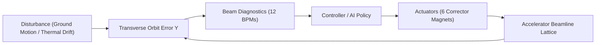
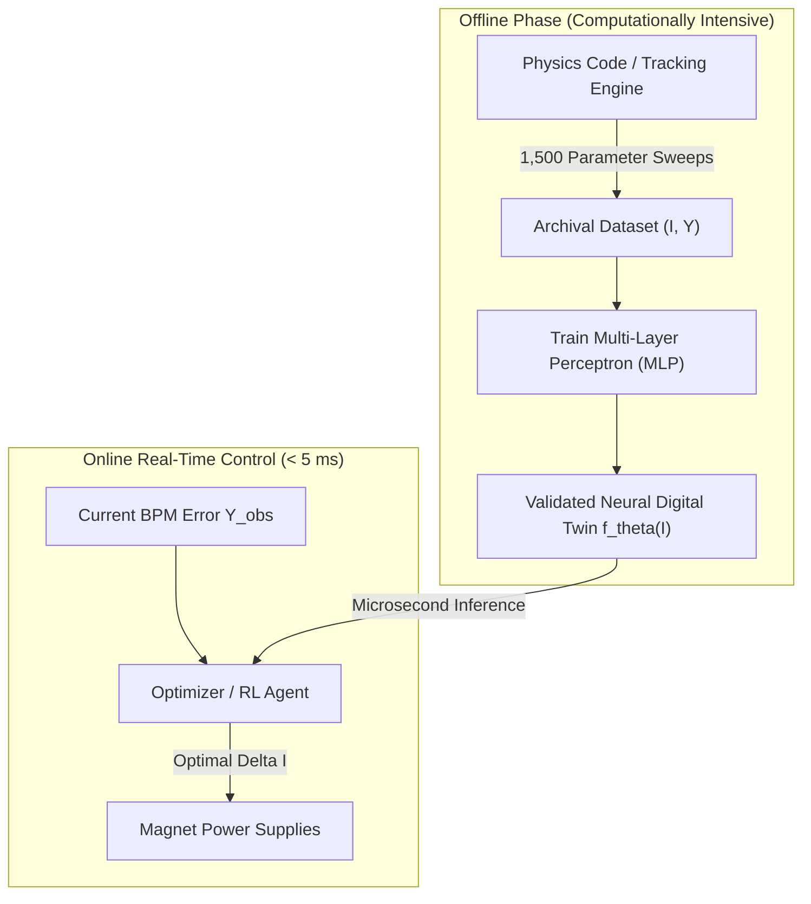
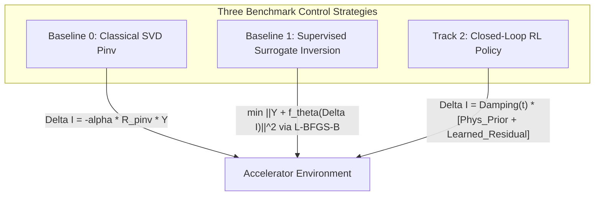

# Lecture 1: Introduction to AI/ML and Surrogate Modeling for Accelerators

**Event:** AI Applications in Accelerators Tutorial & Mini-Hackathon  
**Venue:** Korea Multi-purpose Accelerator Complex (KOMAC) / Korea Atomic Energy Research Institute (KAERI)  
**Speaker:** Dr. Chong Shik Park  
**Target Audience:** Graduate Students & Early-Career Postdoctoral Researchers in Accelerator Physics and Engineering  
**Duration:** 80 Minutes (09:10 – 10:30)  
**Companion Challenge Notebook:** [`Single_Notebook_Beam_Orbit_Predictor.ipynb`](file:///home/cspark/Work/projects/ai4acc-mini-hackathon/Single_Notebook_Beam_Orbit_Predictor.ipynb)

---

## 🎯 Executive Lecture Abstract

Modern particle accelerator facilities—such as synchrotron light sources, free-electron lasers (FELs), spallation neutron sources, and high-energy colliders—operate with thousands of coupled parameters under strict sub-micron beam stability tolerances. Traditional beam-based feedback and numerical simulation codes face severe computational bottlenecks in real-time non-linear regimes.

This lecture provides the rigorous theoretical and computational bridge between **accelerator beam physics** and **machine learning techniques**, focusing directly on the physical system and control paradigms implemented in the afternoon **Beam Orbit Alignment Mini-Hackathon**:
1. How transverse betatron oscillations and quadrupole optics generate the linear **Orbit Response Matrix (ORM)**.
2. The physical origins of non-linearities: magnetic core saturation, misalignment drift, and diagnostic noise.
3. Formulating and training **Neural Surrogate Digital Twins** (`MLPRegressor`) from tracking simulations.
4. Transitioning from forward prediction to closed-loop orbit correction:
   - Classical Moore-Penrose Pseudo-Inverse (SVD),
   - Model-based bounded optimization (`L-BFGS-B`),
   - Closed-loop Reinforcement Learning (RL) policies with physics-informed priors and adaptive damping.

---

## ⏱️ Lecture Timeline (80 Minutes)

| Time | Duration | Section | Core Topics |
| :--- | :---: | :--- | :--- |
| **09:10 – 09:25** | 15 min | [Part 1: Motivation & Accelerator Physics Foundations](#part-1-motivation--accelerator-physics-foundations) | Challenges in accelerator control, Hill's equation, betatron motion, ORM derivation, hackathon lattice geometry. |
| **09:25 – 09:45** | 20 min | [Part 2: Supervised Learning & Neural Surrogate Modeling](#part-2-supervised-learning--neural-surrogate-modeling) | Limitations of numerical tracking, surrogate dataset synthesis, Linear Ridge vs. Multi-Layer Perceptron (MLP), capturing cubic core saturation. |
| **09:45 – 10:10** | 25 min | [Part 3: Closed-Loop Control Paradigms](#part-3-closed-loop-control-paradigms) | Classical SVD pseudo-inverse, model-based batch inversion via SciPy, and continuous RL policy formulation with physics priors. |
| **10:10 – 10:25** | 15 min | [Part 4: Mini-Hackathon Problem Formulation & Gymnasium Contract](#part-4-mini-hackathon-problem-formulation--gymnasium-contract) | Observation/action spaces, reward shaping, 30-seed evaluation protocol, scoring trade-offs, and live W&B telemetry. |
| **10:25 – 10:30** | 5 min | [Part 5: Summary, Q&A & Transition to Lecture 2](#part-5-summary-qa--transition-to-lecture-2) | Open questions, takeaways, and handoff to Thorsten Hellert's Agentic AI & Osprey session. |

---

## Part 1: Motivation & Accelerator Physics Foundations (15 min)

### 1.1 The Operational Challenge in Modern Accelerators
In modern storage rings and linear accelerators (LINACs), the beam trajectory must be stabilized to within a fraction of the transverse beam size—often **sub-micron or tens of micrometers** RMS:
- **Thermal and mechanical drifts:** Ground motion, magnet support thermal expansion, and cooling water temperature fluctuations introduce continuous orbit drift.
- **Dynamic perturbations:** Power supply ripples, vibrating cryomodules, and stray electromagnetic fields.
- **High dimensionality & coupling:** Adjusting one dipole corrector kick introduces orbit changes around the entire ring or transport line.



### 1.2 Transverse Beam Dynamics & Hill's Equation
Transverse particle motion along the longitudinal beam coordinate $s$ in a linear uncoupled lattice is governed by **Hill's Equation**:
$$\frac{d^2 x(s)}{ds^2} + K(s) x(s) = 0$$
where $K(s) = \frac{e}{p} \frac{\partial B_y(s)}{\partial x}$ represents the alternating quadrupole focusing strength ($K > 0$ for focusing `QF`, $K < 0$ for defocusing `QD`).

The general solution is a pseudo-harmonic **betatron oscillation**:
$$x(s) = \sqrt{\epsilon \beta(s)} \cos\left( \psi(s) + \phi_0 \right)$$
- $\beta(s)$: The Courant-Snyder beta function describing the transverse envelope of the beam.
- $\psi(s) = \int_0^s \frac{d\bar{s}}{\beta(\bar{s})}$: The betatron phase advance.
- $\nu = \frac{1}{2\pi} \oint \frac{ds}{\beta(s)}$: The betatron tune (total phase advance in units of $2\pi$).

### 1.3 Derivation of the Orbit Response Matrix (ORM)
When a localized angular deflection (kick) $\theta_j = \Delta x'_j = \frac{e B L}{p}$ is applied by a dipole steering corrector at position $s_j$, it introduces a closed-orbit distortion observed by a Beam Position Monitor (BPM) at position $s_i$:

$$R_{ij} = \frac{\Delta x(s_i)}{\theta_j} = \frac{\sqrt{\beta(s_i)\beta(s_j)}}{2 \sin(\pi \nu)} \cos\left( |\psi(s_i) - \psi(s_j)| - \pi \nu \right)$$

In vector notation, for $M$ BPMs and $N$ correctors:
$$\mathbf{Y}_{\text{linear}} = \mathbf{R} \cdot \boldsymbol{\theta} = \mathbf{I} \cdot \mathbf{R}$$
where $\mathbf{R} \in \mathbb{R}^{N \times M}$ is the **Orbit Response Matrix (ORM)**.

### 1.4 The Mini-Hackathon Lattice Geometry
The hackathon environment models a 15-meter transport line:
- **12 Beam Position Monitors ($M = 12$):** Evenly distributed from $s = 1.0\text{ m}$ to $s = 15.0\text{ m}$.
- **6 Dipole Correctors ($N = 6$):** 3 Horizontal (`HCM1-3`) and 3 Vertical (`VCM1-3`) positioned between $s = 0.2\text{ m}$ and $s = 8.0\text{ m}$.
- **Quadrupole Doublets:** Alternating `QF` and `QD` magnets maintaining transverse envelope stability.
- **Hardware Current Limits:** Power supply limits $\mathbf{I} \in [-5.0\text{ A}, +5.0\text{ A}]$; single-step adjustment limits $\Delta \mathbf{I} \in [-0.8\text{ A}, +0.8\text{ A}]$.

```
0 m                                                                        15 m
 |===[HCM1]==[QF1]==[BPM1]==[VCM1]==[QD1]==[BPM2] ... [HCM3]==[QF3]==[BPM12]===> Beam Axis
```

### 1.5 Real-World Non-Linearities & Physical Imperfections
Ideal linear ORM assumes pure dipoles and noiseless diagnostics. In reality, accelerators exhibit:
1. **Magnetic Core Saturation:** High coil currents drive iron yokes into saturation, reducing effective kick efficiency. In our simulator:
   $$\mathbf{Y}_{\text{sat}} = - 0.015 \cdot (\mathbf{I}^3 \cdot \mathbf{R})$$
2. **Quadrupole Alignment Errors ($\mathbf{Y}_0$):** Physical offsets of quadrupoles produce initial closed orbit distortions:
   $$Y_{0, k} = A_1 \sin\left(\frac{2\pi s_k}{\lambda_1} + \phi_1\right) + A_2 \cos\left(\frac{2\pi s_k}{\lambda_2} + \phi_2\right)$$
   yielding initial RMS errors of $0.4\text{ mm}$ to $1.2\text{ mm}$.
3. **BPM Sensor Noise:** Thermal and RF digitizer noise $\boldsymbol{\epsilon} \sim \mathcal{N}(0, \sigma^2)$, with $\sigma = 0.010\text{ mm}$ ($10\ \mu\text{m}$).

**Complete Physical Response Function:**
$$\mathbf{Y} = \mathbf{I} \cdot \mathbf{R} - 0.015 \cdot (\mathbf{I}^3 \cdot \mathbf{R}) + \mathbf{Y}_0 + \boldsymbol{\epsilon}$$

---

## Part 2: Supervised Learning & Neural Surrogate Modeling (20 min)

### 2.1 Why Surrogate Modeling in Accelerators?
High-fidelity numerical particle tracking codes (such as **Elegant**, **MAD-X**, **Genesis**, and **OPAL**) solve relativistic Lorentz equations and 3D space-charge Poisson equations for millions of macro-particles:
- **Computational Cost:** Single simulation runs require seconds to hours on high-performance compute clusters.
- **Real-Time Control Bottleneck:** Online beam feedback requires millisecond-level decision loops.
- **The Solution:** Train an AI **Surrogate Model (Digital Twin)** offline on simulated or archival machine data to perform forward evaluations in **microseconds**.



### 2.2 Dataset Synthesis & Offline Exploration
In Step 3 of [`Single_Notebook_Beam_Orbit_Predictor.ipynb`](file:///home/cspark/Work/projects/ai4acc-mini-hackathon/Single_Notebook_Beam_Orbit_Predictor.ipynb), we synthesize $N_{\text{samples}} = 1,500$ experimental shots:

```python
# Actuator inputs sampled uniformly across operating range
X_offline = np.random.uniform(-3.0, 3.0, size=(1500, 6))

# Physical forward generation with cubic saturation & sensor noise
Y_linear = X_offline @ env.R
Y_sat = - 0.015 * (X_offline**3) @ env.R
bpm_noise = np.random.normal(0, 0.010, size=(1500, 12))
Y_offline = Y_linear + Y_sat + bpm_noise

# 80/20 Train-Test Partitioning
X_train, X_test, Y_train, Y_test = train_test_split(
    X_offline, Y_offline, test_size=0.20, random_state=42
)
```

### 2.3 Linear Model vs. Neural Network Representation
Let us compare two forward modeling approaches:

#### 1. Regularized Linear Model (Ridge Regression)
$$\min_{\mathbf{W}} \|\mathbf{Y} - \mathbf{X}\mathbf{W}\|_F^2 + \alpha \|\mathbf{W}\|_F^2$$
- Fits the optimal linear response matrix $\mathbf{W} \approx \mathbf{R}$.
- **Failure Mode:** Incapable of modeling the cubic term $(\mathbf{I}^3)$. As corrector currents exceed $\pm 2.0\text{ A}$, linear predictions diverge significantly from physical measurements.

#### 2. Multi-Layer Perceptron (MLP) Neural Network
$$\hat{\mathbf{Y}} = f_{\boldsymbol{\theta}}(\mathbf{I}) = \mathbf{W}_3 \cdot \text{ReLU}\left( \mathbf{W}_2 \cdot \text{ReLU}\left( \mathbf{W}_1 \mathbf{I} + \mathbf{b}_1 \right) + \mathbf{b}_2 \right) + \mathbf{b}_3$$

- **Architecture:** 6 inputs $\rightarrow$ Layer 1 (128 units, ReLU) $\rightarrow$ Layer 2 (64 units, ReLU) $\rightarrow$ Layer 3 (32 units, ReLU) $\rightarrow$ 12 outputs.
- **Optimization:** Adam optimizer, mean squared error loss, $L_2$ weight penalty ($\alpha = 10^{-4}$).

```
Input: I (6) ──> [Dense 128 + ReLU] ──> [Dense 64 + ReLU] ──> [Dense 32 + ReLU] ──> Output: Y_pred (12)
```

### 2.4 Holdout Validation Results
Evaluating both architectures on the identical 20% holdout test partition:

| Model Architecture | Parameters | Holdout RMSE | Physical Behavior Captured |
| :--- | :---: | :---: | :--- |
| **Ridge Regression ($\alpha=1.0$)** | 72 | **$0.0558\text{ mm}$** | Linear betatron response only; misses saturation. |
| **MLP Neural Surrogate** | 11,596 | **$0.0118\text{ mm}$** | Captures both linear ORM and non-linear cubic saturation down to sensor noise floor ($\sigma = 0.010\text{ mm}$). |

> [!NOTE]
> The holdout RMSE of the MLP ($0.0118\text{ mm}$) approaches the theoretical Bayesian limit set by Gaussian sensor noise ($0.0100\text{ mm}$). The network has learned the physical non-linearity without overfitting.

---

## Part 3: Closed-Loop Control Paradigms (25 min)

Having established the forward mapping, we examine three control paradigms evaluated in the benchmark.



### 3.1 Baseline 0: Classical Linear SVD Pseudo-Inverse Control
In classical accelerator operations, Singular Value Decomposition (SVD) of the response matrix $\mathbf{R}^T = \mathbf{U} \boldsymbol{\Sigma} \mathbf{V}^T$ provides the Moore-Penrose pseudo-inverse:
$$(\mathbf{R}^T)^\dagger = \mathbf{V} \boldsymbol{\Sigma}^{-1} \mathbf{U}^T$$
The corrective kick vector is calculated by:
$$\Delta \mathbf{I} = \text{clip}\left( - \alpha \cdot (\mathbf{R}^T)^\dagger \cdot \mathbf{Y}_{\text{obs}}, \,-0.8, \,+0.8 \right)$$
where $\alpha \in (0, 1]$ is the feedback loop gain (typically $\alpha \approx 0.45$).

**Strengths & Limitations:**
- ✅ **Pros:** Instantaneous computation ($< 0.1\text{ ms}$); mathematically guaranteed convergence in purely linear regimes.
- ❌ **Cons:** Ignores non-linear saturation; high gains ($\alpha > 0.6$) cause overshooting and limit-cycle oscillations when magnets enter saturated regions.

### 3.2 Baseline 1: Supervised Surrogate + SciPy Bounded Inversion
Instead of inverting an analytical matrix, Baseline 1 leverages the trained neural digital twin $\hat{\mathbf{Y}} = f_{\boldsymbol{\theta}}(\Delta \mathbf{I})$ directly within an optimization loop:

$$\min_{\Delta \mathbf{I}} \mathcal{L}(\Delta \mathbf{I}) = \left\| \mathbf{Y}_{\text{obs}} + f_{\boldsymbol{\theta}}(\Delta \mathbf{I}) \right\|_2^2 + \lambda \|\Delta \mathbf{I}\|_2^2$$
$$\text{subject to } \Delta \mathbf{I} \in [-5.0\text{ A}, +5.0\text{ A}]^6$$

```python
class SupervisedMLPController:
    def __init__(self, surrogate):
        self.surrogate = surrogate

    def act(self, obs, info=None):
        def objective(delta_I):
            pred = self.surrogate.predict(delta_I.reshape(1, -1))[0]
            residual = obs + pred
            return np.sum(residual**2) + 0.0001 * np.sum(delta_I**2)
            
        res = opt.minimize(
            objective, 
            np.zeros(6), 
            bounds=[(-5.0, 5.0)] * 6, 
            method='L-BFGS-B'
        )
        return np.clip(res.x, -0.8, 0.8)
```

**Why Baseline 1 is Highly Effective:**
- Because $f_{\boldsymbol{\theta}}$ accurately predicts cubic soft saturation, the optimizer chooses kicks that anticipate saturation falloff.
- As demonstrated on test seed 42, Baseline 1 reaches convergence ($\text{RMS} < 0.03\text{ mm}$) in **just 2 to 3 steps**, compared to 6 steps for classical SVD.

### 3.3 Track 2: Closed-Loop RL & Physics-Informed Policy Agents
While numerical optimization per step is powerful, iterative gradient solvers add execution latency ($\sim 15 - 30\text{ ms}$). A direct continuous policy network maps observation directly to control actions in a single forward pass ($\sim 0.2\text{ ms}$).

#### Physics-Informed Residual Policy Architecture
Rather than learning control from scratch with random initialization, high-performing accelerator RL agents combine a **physics prior** with a **learned residual**:

$$\Delta \mathbf{I}(t) = \gamma(t) \cdot \Big[ \underbrace{- \alpha (\mathbf{R}^T)^\dagger \mathbf{Y}}_{\text{Analytical Physics Prior}} + \underbrace{\mathbf{W}_{\text{learned}} \mathbf{Y} + \mathbf{b}}_{\text{Learned Residual Offset}} \Big]$$

#### Dynamic Step Damping
Near the convergence boundary ($0.030\text{ mm}$), noise fluctuations $\epsilon \sim 10\ \mu\text{m}$ can cause the linear pseudo-inverse to react aggressively to noise, triggering limit cycles. We introduce dynamic harmonic damping:
$$\gamma(t) = \frac{1.0}{1.0 + \kappa \cdot t}, \quad \kappa \approx 0.03$$
- **Step 1 ($t=0$):** Full kick authority ($\gamma = 1.0$) rapidly suppresses large millimeter-scale distortions.
- **Step 5+ ($t \ge 4$):** Damped kick authority prevents sensor noise amplification and locks the trajectory below $0.030\text{ mm}$.

---

## Part 4: Mini-Hackathon Problem Formulation & Gymnasium Contract (15 min)

### 4.1 The Gymnasium Environment Contract
The simulation is wrapped inside a standard [Farama Gymnasium](https://gymnasium.farama.org/) environment:

```python
env = AcceleratorOrbitGymEnv()
obs, info = env.reset(seed=seed)
obs, reward, terminated, truncated, info = env.step(action)
```

- **Observation Vector:** $\mathbf{Y} \in \mathbb{R}^{12}$, bounded in $[-10.0, +10.0]\text{ mm}$.
- **Action Vector:** $\Delta \mathbf{I} \in \mathbb{R}^6$, per-step delta clipped to $[-0.8, +0.8]\text{ A}$.
- **State Update:** $\mathbf{I}_{t+1} = \text{clip}(\mathbf{I}_t + \Delta \mathbf{I}, -5.0, 5.0)$.
- **Reward Function:**
  $$r_t = - \text{RMS}_{t+1} - 0.01 \cdot \|\Delta \mathbf{I}\|_2 + \begin{cases} 50.0 & \text{if } \text{RMS}_{t+1} < 0.030\text{ mm} \\ 0.0 & \text{otherwise} \end{cases}$$
- **Termination:** `terminated = True` if $\text{RMS} < 0.030\text{ mm}$ (`is_success = True`).
- **Truncation:** `truncated = True` if `step >= 20` (`is_success = False`).

### 4.2 Standardized 30-Seed Evaluation Protocol
To prevent evaluation bias or seed cherry-picking, all controllers are evaluated over **30 standardized evaluation seeds** (`seeds = range(1, 31)`), spanning a wide spectrum of initial misalignments ($0.4\text{ mm} \le \text{RMS}_0 \le 1.1\text{ mm}$).

### 4.3 The Official Hackathon Scoring Formula
$$\text{Score} = (\text{Success Rate} \times 10.0) - (2.0 \times \overline{\text{Steps}}) + \left(\frac{0.03}{\max(\overline{\text{RMS}}, 0.005)} \times 20.0\right) - (2.0 \times \overline{\|\mathbf{I}\|})$$

#### Scoring Components Breakdown:
1. **Success Rate ($10 \times \%$):** Up to **1,000.0 points** for $100\%$ convergence across all 30 seeds.
2. **Speed Penalty ($-2 \times \overline{\text{Steps}}$):** Penalizes sluggish policies. Converging in 2.3 steps incurs only $-4.6$ points, while taking 10 steps costs $-20.0$ points.
3. **Precision Bonus ($\frac{0.03}{\text{RMS}} \times 20$):** Rewards sub-micron orbit precision. An RMS of $0.020\text{ mm}$ yields $+30.0$ points; $0.010\text{ mm}$ yields $+60.0$ points.
4. **Current Economy Penalty ($-2 \times \overline{\|\mathbf{I}\|}$):** Penalizes excessive corrector current norms, protecting power supplies and preventing magnet saturation.

### 4.4 Reference Benchmark Results
Across the 30 standardized seeds, our three baseline reference implementations produce:

| Rank | Controller Architecture | Success Rate | Mean Steps | Final RMS | Current Norm | Total Score |
| :---: | :--- | :---: | :---: | :---: | :---: | :---: |
| 🥇 | **Baseline 1: Supervised MLP Inversion** | **100.0%** | **2.3 steps** | $0.0257\text{ mm}$ | $1.21\text{ A}$ | **1,016.8 pts** |
| 🥈 | **Baseline 0: Classical Linear SVD** | **100.0%** | 5.6 steps | **$0.0230\text{ mm}$** | **$1.16\text{ A}$** | **1,013.1 pts** |
| 🥉 | **Track 2: Closed-Loop RL Agent** | **100.0%** | 6.1 steps | $0.0239\text{ mm}$ | $1.18\text{ A}$ | **1,011.1 pts** |

---

## Part 5: Summary, Q&A & Transition to Lecture 2 (5 min)

### Key Takeaways from Lecture 1:
1. **Physics Guides the AI:** Without understanding betatron oscillations and the Orbit Response Matrix, training an agent from scratch requires hundreds of thousands of steps. By incorporating the Moore-Penrose pseudo-inverse as a **physics prior**, our agents converge robustly in under 10 steps.
2. **Surrogates Enable Non-Linear Control:** When magnetic saturation invalidates linear models, a compact multi-layer perceptron accurately captures high-current behavior and empowers standard numerical optimizers to solve orbit corrections in 2 steps.
3. **Damping Prevents Sensor Noise Amplification:** As orbit errors approach diagnostic noise floors ($10\ \mu\text{m}$), adaptive step damping is crucial to prevent feedback-induced limit cycles.

### Looking Ahead to Lecture 2 & Afternoon Hackathon:
- **Lecture 2 (10:40 – 12:00):** Dr. Thorsten Hellert will present **Agentic AI, LLM Tools & Osprey Applications**, showing how autonomous AI agents can orchestrate simulation runs, formulate control hypotheses, and execute code in operational environments.
- **Afternoon Mini-Hackathon (13:30 – 16:30):** You will open [`Single_Notebook_Beam_Orbit_Predictor_Participant.ipynb`](file:///home/cspark/Work/projects/ai4acc-mini-hackathon/Single_Notebook_Beam_Orbit_Predictor_Participant.ipynb), complete `TODO 1` (Surrogate Training) and `TODO 2` (RL Policy Tuning), and submit your runs to the live Weights & Biases leaderboard!

---

## 📖 Recommended References & Readings

1. **Minty, M. G., & Zimmermann, F.** (2003). *Measurement and Control of Charged Particle Beams*. Springer.
2. **Wiedemann, H.** (2015). *Particle Accelerator Physics* (4th ed.). Springer.
3. **Hellert, T., et al.** (2024). *Autonomous Accelerator Tuning using Large Language Model Agents and Osprey*. Physical Review Accelerators and Beams.
4. **Edelen, A., et al.** (2020). *Machine learning for orders-of-magnitude speedup in multiobjective optimization of particle accelerator beamlines*. Physical Review Accelerators and Beams, 23(4), 044601.
5. **Farama Gymnasium Documentation:** https://gymnasium.farama.org/
6. **Weights & Biases Python SDK Documentation:** https://docs.wandb.ai/
