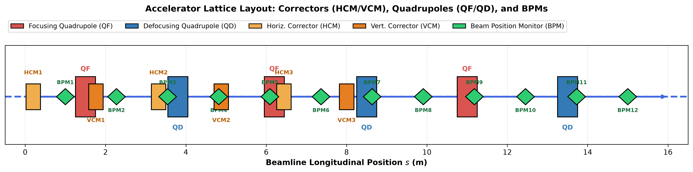

# AI Applications in Accelerators: Tutorial & Mini-Hackathon

Welcome to the **AI Applications in Accelerators Tutorial & Mini-Hackathon** repository. This project hosts the computational challenge, simulation environment, benchmark notebooks, and documentation for the hands-on mini-hackathon.

> **Access:** this repository is available to instructors and organizers only. Participants do not clone it; they receive the challenge as a Docker container (see [Getting Started](#getting-started--environment-setup)).

---

## 📋 Table of Contents

- [Overview](#overview)
- [The Challenge: Beam Orbit Alignment Benchmark](#the-challenge-beam-orbit-alignment-benchmark)
- [Master Schedule & Program](#master-schedule--program)
- [Repository Structure](#repository-structure)
- [Getting Started & Environment Setup](#getting-started--environment-setup)
  - [For Participants: Docker Container](#for-participants-docker-container)
  - [For Instructors & Organizers: Local Development](#for-instructors--organizers-local-development)
- [Weights & Biases (W&B) Leaderboard](#weights--biases-wb-leaderboard)
- [Benchmark Results & Scoring](#benchmark-results--scoring)
- [Participant Workflow & Instructions](#participant-workflow--instructions)
- [Documentation Index](#documentation-index)

---

## 🎯 Overview

Modern particle accelerators rely increasingly on machine learning and autonomous agentic workflows to handle high-dimensional, non-linear, and time-critical beam control tasks. This tutorial bridges theoretical foundations with real-time operational applications:

- **Workshop Registration:** [https://indico.korea.ac.kr/event/114/](https://indico.korea.ac.kr/event/114/)
- **Morning Lectures:**
  - **Lecture 1:** *AI/ML Foundations and Closed-Loop Control for Particle Accelerators* — **Chong Shik Park, Ph.D.**
  - **Lecture 2:** *Agentic AI for Accelerator Research: Osprey Applications* — **Thorsten Hellert, Ph.D.**
- **Afternoon Mini-Hackathon:**
  - Hands-on closed-loop control challenge in a standardized [Gymnasium](https://gymnasium.farama.org/) environment.
  - Multi-track benchmarking: Classical Linear ORM (Baseline 0), Supervised Neural Surrogate Inversion (Track 1), Closed-Loop Reinforcement Learning (Track 2), and Closed-Loop Bayesian Optimization with Gaussian Processes (Track 3).
  - Live real-time scoring streamed to a unified [Weights & Biases (W&B)](https://wandb.ai) leaderboard.

---

## 🔬 The Challenge: Beam Orbit Alignment Benchmark

Participants design, optimize, and benchmark closed-loop accelerator controllers to steer an off-axis particle beam back to nominal alignment within an optical transport lattice.



*Beamline layout: 3 horizontal and 3 vertical correctors (HCM/VCM), alternating focusing and defocusing quadrupoles (QF/QD), and 12 beam position monitors (BPM) along the transport line.*

### Physical Lattice & Hardware Specification
- **Actuators ($X$):** 6 dipole steering magnets (3 Horizontal `HCM1-3`, 3 Vertical `VCM1-3`).
  - Total Current Range: $[-5.0\text{ A}, +5.0\text{ A}]$
  - Step Action Range ($\Delta I$): $[-0.8\text{ A}, +0.8\text{ A}]$
- **Diagnostics ($Y$):** 12 Beam Position Monitors (BPMs) positioned along a 15-meter transport line measuring beam offset in millimeters (mm).
- **Optics & Non-linearities:**
  - Alternating quadrupole focusing/defocusing magnets (`QF`, `QD`).
  - Linear Orbit Response Matrix (ORM) of a single-pass transport line: a corrector at $s_i$ only moves the orbit at BPMs downstream ($s_j > s_i$):
    $$R_{ij} = \frac{1.2\,\sin\!\big(2\pi \cdot 0.18\,(s_j - s_i)\big)}{1 + 0.05\,(s_j - s_i)} \quad (s_j > s_i), \qquad R_{ij} = 0 \text{ otherwise}$$
  - Initial distortion: unknown steering errors at all six corrector locations drawn from the episode seed, $\mathbf{Y}_0 = \mathbf{a} \cdot \mathbf{R}$ with $a_k \sim \mathcal{U}(-2.5, 2.5)$ A (initial RMS $0.93$–$3.59\text{ mm}$ on seeds 1–30). Cancelling it needs currents up to about $2.8\text{ A}$, deep in the saturation, and about 3 to 4 steps of at most $0.8\text{ A}$.
  - Non-linear magnetic core saturation: $-0.015 \cdot X^3 \cdot R$
  - Realistic Gaussian diagnostic noise: $\epsilon \sim \mathcal{N}(0, 0.010\text{ mm})$
- **Goal Condition:** Bring Root-Mean-Square (RMS) beam orbit error below threshold:
  $$\text{RMS} = \sqrt{\frac{1}{12}\sum_{i=1}^{12} Y_i^2} < 0.030\text{ mm}$$
  within a budget of **50 control steps**.

---

## ⏱️ Master Schedule & Program

| Time (KST) | Session Type | Details & Lecturers |
| :---: | :---: | :--- |
| **09:00 – 09:10** | Welcome & Orientation | Opening remarks, workshop objectives, setup verification & W&B intro |
| **09:10 – 10:30** | **Lecture 1** | **AI/ML Foundations and Closed-Loop Control for Particle Accelerators**<br>Lecturer: Chong Shik Park, Ph.D. (Korea University, Sejong) |
| **10:30 – 10:40** | Break & Discussion | Intermission and Q&A |
| **10:40 – 12:00** | **Lecture 2** | **Agentic AI for Accelerator Research: Osprey Applications**<br>Lecturer: Thorsten Hellert, Ph.D. |
| **12:00 – 13:30** | Lunch & Networking | Complimentary lunch and attendee collaboration |
| **13:30 – 16:30** | **Mini-Hackathon** | **Beam Orbit Alignment Benchmark Challenge**<br>• Track 1: Supervised Neural Surrogate (MLP) Inverse Optimization<br>• Track 2: Physics-Informed Closed-Loop Reinforcement Learning (RL)<br>• Track 3: Gaussian Process Bayesian Optimization (BO) Controller |
| **16:30 – 17:00** | Leaderboard Awards | W&B Live Leaderboard review, awards presentation & closing remarks |

The same schedule appears in the workshop announcement, available in Korean ([`docs/Announcement_KR.md`](docs/Announcement_KR.md)) and English ([`docs/Announcement_EN.md`](docs/Announcement_EN.md)).

---

## 📂 Repository Structure

```
.
├── README.md                                         # Main workshop & challenge guide (this file)
├── AGENTS.md                                         # Operational instructions for AI assistants & agents
├── setup.sh                                          # Virtual environment setup & activation script
├── pyproject.toml                                    # Python package & build metadata (PEP 517/621)
├── Dockerfile                                        # Participant container image (JupyterLab + challenge)
├── docker-compose.yml                                # Local build-and-run configuration for organizers
├── .dockerignore                                     # Keeps the solution notebook, sources and secrets out of the image
│
├── docs/                                             # Supporting workshop documentation & setup guides
│   ├── Announcement_KR.md / Announcement_EN.md       # Workshop announcement (Korean / English)
│   ├── Announcement.docx                             # Announcement (Word, built by scripts/build_announcement_docx.py)
│   ├── DOCKER_INSTALL_GUIDE.md                       # Docker installation steps for Linux, macOS & Windows
│   ├── DOCKER_GUIDE.md                               # Docker, Docker Compose & Docker Hub user guide
│   ├── PARTICIPANT_MODIFICATION_GUIDE.md             # What participants may change for each controller, and callback rules
│   ├── CALLBACK_EXAMPLES.md                          # Callback schemas and tested examples with their measured effect
│   ├── WANDB_LEADERBOARD_GUIDE.md                    # W&B leaderboard guide for the organizer and participants
│   ├── MULTI_AGENT_BENCHMARK_INSTRUCTIONS.md         # Protocol for the 10-agent benchmark with live W&B submission
│   ├── MULTI_AGENT_TOURNAMENT_REPORT1.md             # Superseded earlier tournament report (scores not confirmed on W&B)
│   ├── MULTI_AGENT_TOURNAMENT_REPORT2.md             # 10-agent W&B submission test (2026-11-14, earlier 2-kick benchmark)
│   ├── MULTI_AGENT_TOURNAMENT_REPORT3.md             # Tournament 3 on the current 6-kick benchmark (2026-11-15)
│   ├── experiments/                                  # Multi-agent results logs and each agent's executed notebook
│   ├── pdf/                                          # PDF builds of the Markdown guides (scripts/build_docs_pdf.py)
│   ├── Technical Preparation.docx                    # Tutorial readiness and curriculum guide
│   ├── Hackathon Project Guide.docx                  # Challenge rules, physics spec, and scoring breakdown
│   └── Mini-Hackathon Participant Instructions.docx   # Quick-reference participant milestone checklist
│
├── lecture_notes/                                    # Lecture 1 notes (Dr. Chong Shik Park)
│   ├── Lecture_1_AI_ML_Foundations_and_Control_Notes.md   # Notes (Markdown)
│   ├── Lecture_1_AI_ML_Foundations_and_Control_Notes.tex  # Notes (LaTeX source)
│   └── Lecture_1_AI_ML_Foundations_and_Control_Notes.pdf  # Compiled notes (PDF, 24 pages)
│
├── presentations/                                    # Slide decks and speaker narratives
│   ├── Lecture_1_AI_ML_Foundations_and_Control_Slides.tex  # Lecture 1 LaTeX slide source
│   ├── Lecture_1_AI_ML_Foundations_and_Control_Slides.pptx # Lecture 1 PowerPoint deck (35 slides)
│   ├── Lecture_1_AI_ML_Foundations_and_Control_Slides.pdf  # Lecture 1 compiled deck (PDF, 35 slides)
│   ├── Lecture_1_Slide_Narratives_EN.tex / .pdf            # Lecture 1 speaker narratives, English (one page per slide)
│   ├── Lecture_1_Slide_Narratives_KR.tex / .pdf            # Lecture 1 speaker narratives, Korean
│   ├── Mini_Hackathon_Beam_Orbit_Alignment_Slides.tex      # Mini-hackathon LaTeX slide source
│   ├── Mini_Hackathon_Beam_Orbit_Alignment_Slides.pptx     # Mini-hackathon PowerPoint deck (10 slides)
│   └── Mini_Hackathon_Beam_Orbit_Alignment_Slides.pdf      # Mini-hackathon compiled deck (PDF, 10 slides)
│
├── notebooks/                                        # Jupyter notebooks
│   ├── Single_Notebook_Beam_Orbit_Predictor_Participant.ipynb  # Challenge notebook for participants (with TODOs)
│   ├── Single_Notebook_Beam_Orbit_Predictor_Solution.ipynb     # Worked solution with saved outputs (organizers only)
│   └── Transfer_Matrix_Surrogate_Phase_Space.ipynb             # Lecture 1, slides 14-15: NN surrogate of a FODO transfer matrix in phase space
│
├── src/                                              # Python simulation & controller package
│   ├── __init__.py                                   # Package exports
│   ├── environment.py                                # AcceleratorOrbitGymEnv simulation and offline dataset generator
│   ├── controllers.py                                # Reference controllers: SVD, MLP inversion, RL agent, Bayesian optimization
│   ├── benchmark.py                                  # 30-seed evaluation harness, scoring & W&B telemetry
│   └── visualization.py                              # Beamline schematic and trajectory plots
│
├── tests/                                            # Unit tests (pytest) for the environment, controllers, benchmark and plots
│
├── scripts/                                          # Build and release scripts (organizers)
│   ├── create_bundle.sh / docker_publish.sh / image_common.sh   # Build, verify and publish the image and the offline bundle
│   ├── build_lecture_1_pptx.py / build_hackathon_pptx.py        # Build the two PowerPoint decks
│   ├── build_slide_narratives.py                     # Build the English and Korean narrative documents
│   ├── build_transfer_matrix_notebook.py             # Generate (and execute) the transfer-matrix notebook
│   ├── update_notebooks.py                           # Regenerate the shared cells of the challenge notebooks
│   ├── build_docs_pdf.py / build_announcement_docx.py           # Build docs/pdf/*.pdf and the announcement Word file
│   ├── generate_sl_rl_schematic.py                   # Draw the three-paradigm schematic used in the slides
│   └── cleanup_wandb.py                              # Remove test runs from the W&B project
│
└── img/                                              # Figures used by the slides, notes and notebooks
    ├── beamline.png                                  # Transport lattice schematic
    ├── benchmark_trajectories.png                    # Reference-controller trajectories (slide 32)
    ├── activation_functions.png, mlp_schematic.png, forward_sl_and_rl_schematic.png   # Lecture figures
    └── ku_logo.png                                   # Logo used on the slides
```

---

## 🚀 Getting Started & Environment Setup

### For Participants: Docker Container

Participants run the challenge in the official Docker container; no Git clone or local Python installation is needed. Install Docker beforehand with [`docs/DOCKER_INSTALL_GUIDE.md`](docs/DOCKER_INSTALL_GUIDE.md), then download and test the image with [`docs/DOCKER_GUIDE.md`](docs/DOCKER_GUIDE.md).

**On the day**, start the environment with the launcher from the organizer's bundle, keeping `wandb.apikey` in the same folder so scores reach the live leaderboard:

- **Windows:** double-click `run_hackathon_windows.bat`.
- **macOS / Linux:** run `./run_hackathon_mac_linux.sh`.

The launcher checks Docker, loads the image, passes the leaderboard key to the container, and opens JupyterLab at **`http://localhost:8888/lab`**. Without the launcher, the same container starts with:

```bash
docker run -it --rm -p 127.0.0.1:8888:8888 cspark7701/ai4acc-hackathon-2026:latest
```

The container includes Python, all required packages (`gymnasium`, `scikit-learn`, `wandb`, `jupyterlab`), the participant notebook, the lecture PDFs, the participant guides (`PARTICIPANT_MODIFICATION_GUIDE.pdf`, `CALLBACK_EXAMPLES.pdf`), and the companion notebook `Transfer_Matrix_Surrogate_Phase_Space.ipynb` for Lecture 1 (slides 14-15). Download your notebook with **File → Download** before stopping the container; its files are deleted when it stops.

### For Instructors & Organizers: Local Development

With access to this repository, set up a local environment with the provided [`setup.sh`](setup.sh) script. It creates a virtual environment (`ai4acc`), installs the package with its development tools (`pip install -e ".[dev]"`), and activates it:

```bash
source setup.sh
jupyter lab notebooks/Single_Notebook_Beam_Orbit_Predictor_Participant.ipynb
```

To build the container from the repository, run `docker compose up`. Building, publishing to Docker Hub, and creating the offline participant bundle are covered in [`docs/DOCKER_GUIDE.md`](docs/DOCKER_GUIDE.md) and `scripts/create_bundle.sh`.

---

## 📊 Weights & Biases (W&B) Leaderboard

All evaluations automatically push telemetry and scoring to the live workshop leaderboard.
See **[`docs/WANDB_LEADERBOARD_GUIDE.md`](docs/WANDB_LEADERBOARD_GUIDE.md)** for how the organizer creates the `ai4acc-mini-hackathon-2026` leaderboard and how participants submit to it.

1. **Submission:** Participants start the container with the launcher from the organizer's bundle. It passes the shared leaderboard key in `wandb.apikey` to the container, so no W&B account or login is needed.
2. **Configure in Notebook:**
   ```python
   WANDB_PROJECT = "ai4acc-mini-hackathon-2026"
   WANDB_ENTITY = "ai4acc-mini-hackathon-2026"   # [DO NOT CHANGE] Preset workshop entity
   TEAM_NAME = "Team_01"                         # Your unique hackathon team name
   ```
3. **Logged Telemetry:**
   - Summary scalar metrics: `challenge_score` (0–1000) and its parts `score_success`, `score_speed`, `score_precision`, plus `success_rate_pct`, `mean_steps`, `mean_final_rms_mm`, `mean_current_norm_A`, `mean_latency_ms`.
   - Artifact table: `seed_breakdown_table` tracking individual seed outcomes across 30 standardized seeds.
   - Live dynamic convergence plots and dual orbit trajectory diagrams.

---

## 🏆 Benchmark Results & Scoring

### Official Scoring Formula

Controller performance is evaluated across **30 standardized test seeds** (`seeds=range(1, 31)`). Each seed is scored separately and the official score is the mean:

$$\text{Score} = \frac{1}{30}\sum_{k=1}^{30} s_k, \qquad
s_k = \begin{cases}
400 + 300\,\max\!\left(0,\,\dfrac{20 - n_k}{19}\right) + 300\,\text{clip}\!\left(\dfrac{\ln(0.030/\text{RMS}_k)}{\ln(0.030/0.010)},\,0,\,1\right) & \text{if seed } k \text{ succeeds} \\
0 & \text{otherwise}
\end{cases}$$

- **Per-seed score $s_k$ (0 to 1000 points):** a seed that does not reach $\text{RMS} < 0.030\text{ mm}$ within 50 steps scores 0. A successful seed earns:
  - **Success (400 pts):** for reaching the target at all.
  - **Speed (up to 300 pts):** full points when converging in 1 step ($n_k = 1$), falling linearly to 0 at 20 steps (episodes may run up to 50 steps).
  - **Precision (up to 300 pts):** 0 at the $0.030\text{ mm}$ target, rising on a log scale to full points at the $0.010\text{ mm}$ sensor noise floor. Each factor of improvement in residual orbit counts equally; $0.017\text{ mm}$ earns about half.
- **Score:** the mean of $s_k$ over the 30 seeds, from 0 to 1000. Failures cost the most, so robustness comes first; among robust controllers, speed and landing precision separate the ranks.
- **Current norm** $\overline{\|\mathbf{I}\|}$ is still reported but not scored: it is set mainly by the size of the initial distortion and varies by only a few percent between controllers.

### Reference Benchmark Performance

Measured with the current code and the unmodified participant notebook (reference controllers). The Solution notebook (`notebooks/Single_Notebook_Beam_Orbit_Predictor_Solution.ipynb`, organizers only) contains a worked solution that scores 635.277 / 924.192 / 939.981 / 909.942 for Baseline 0 and Tracks 1–3.

| Rank | Controller / Agent Architecture | Success Rate | Mean Steps | Final RMS | Current Norm | Official Score |
| :---: | :--- | :---: | :---: | :---: | :---: | :---: |
| 🥇 | **Track 3: Bayesian Optimization Controller** | 100.0% | 3.6 steps | 0.0136 mm | 3.85 A | **878.384 pts** |
| 🥈 | **Baseline 1 (Track 1): Supervised MLP Surrogate Inversion** | 100.0% | 4.0 steps | 0.0197 mm | 3.84 A | **779.169 pts** |
| 🥉 | **Baseline 0: Classical Linear SVD Controller** | 100.0% | 9.4 steps | 0.0235 mm | 3.80 A | **635.277 pts** |
| 4 | **Track 2: Closed-Loop RL / Adaptive Policy** | 100.0% | 10.8 steps | 0.0256 mm | 3.79 A | **590.559 pts** |

---

## 🛠️ Participant Workflow & Instructions

Follow these steps in [Single_Notebook_Beam_Orbit_Predictor_Participant.ipynb](notebooks/Single_Notebook_Beam_Orbit_Predictor_Participant.ipynb). What you may change in each step is listed in [`docs/PARTICIPANT_MODIFICATION_GUIDE.md`](docs/PARTICIPANT_MODIFICATION_GUIDE.md).

1. **Step 0 & 1:** Run environment setup and visualize the accelerator lattice schematic.
2. **Step 2:** Instantiate the `AcceleratorOrbitGymEnv` simulation environment.
3. **Step 3 (TODO 1):** Train the forward surrogate models (Linear Ridge and Multi-Layer Perceptron) on offline beam data and inspect holdout RMSE.
4. **Step 4 (Baseline 0 & Baseline 1 / Track 1):** Baseline 0, the classical SVD controller, is a fixed reference. Baseline 1 inverts your TODO 1 surrogate with SciPy `L-BFGS-B`, so a more accurate surrogate improves its score.
5. **Step 4 (TODO 2 / Track 2):** Implement and tune your custom closed-loop policy agent: gain (up to about 1.2), saturation compensation on the total current from `info["currents"]`, damping schedules and reward shaping.
6. **Step 4 (TODO 3 / Track 3):** Implement and tune your sample-efficient Bayesian Optimization controller with GaussianProcessRegressor and Lower Confidence Bound (LCB) acquisition.
7. **Step 4 (optional callbacks):** Register `step_callback` / `episode_callback` functions for Baseline 1, Track 2 and Track 3 in the `CALLBACKS` dictionary at the end of Step 4 (see [`docs/CALLBACK_EXAMPLES.md`](docs/CALLBACK_EXAMPLES.md)). Baseline 0 always runs without callbacks.
8. **Step 5:** Run the locked benchmark cell, which evaluates all four controllers on the 30 seeds, passes your `CALLBACKS`, and logs each run to W&B with its URL and score.
9. **Step 6 & 7:** Generate trajectory alignment plots and prepare your team's 3-minute showcase presentation.

---

## 📚 Documentation Index

For detailed guidelines, refer to the included guides:
- [Lecture 1 Notes: AI/ML Foundations & Closed-Loop Control (Markdown)](lecture_notes/Lecture_1_AI_ML_Foundations_and_Control_Notes.md) — Master curriculum notes for Morning Session 1.
- [Lecture 1 Notes: AI/ML Foundations & Closed-Loop Control (PDF Monograph)](lecture_notes/Lecture_1_AI_ML_Foundations_and_Control_Notes.pdf) — Compiled 24-page PDF.
- [Lecture 1 Slides: AI/ML Foundations & Closed-Loop Control (PDF Deck)](presentations/Lecture_1_AI_ML_Foundations_and_Control_Slides.pdf) — 35-slide presentation deck.
- Lecture 1 Slide Narratives: [English](presentations/Lecture_1_Slide_Narratives_EN.pdf) and [Korean](presentations/Lecture_1_Slide_Narratives_KR.pdf) — Speaker script, teaching focus, expected Q&A and transition for each slide.
- [Transfer-Matrix Surrogate Notebook](notebooks/Transfer_Matrix_Surrogate_Phase_Space.ipynb) — Companion to Lecture 1, slides 14-15: a neural surrogate of a FODO transfer matrix compared with the matrix in phase space (22 figures).
- [Mini-Hackathon Slides: Beam Orbit Alignment Benchmark (PDF Deck)](presentations/Mini_Hackathon_Beam_Orbit_Alignment_Slides.pdf) — Comprehensive 10-slide orientation deck for the afternoon hackathon session.
- [Lecture 1 LaTeX Source](lecture_notes/Lecture_1_AI_ML_Foundations_and_Control_Notes.tex) — LaTeX document source code.
- [Hackathon Project Guide (Word Document)](<docs/Hackathon Project Guide.docx>) — Complete rules, physics derivations, and scoring breakdown.
- [Technical Preparation Guide (Word Document)](<docs/Technical Preparation.docx>) — Detailed lecture syllabus, setup recommendations, and schedule.
- [Mini-Hackathon Participant Instructions (Word Document)](<docs/Mini-Hackathon Participant Instructions.docx>) — Quick participant checklist.
- [W&B Leaderboard Guide](docs/WANDB_LEADERBOARD_GUIDE.md) — Leaderboard setup for the organizer and submission steps for participants.
- [Participant Modification Guide](docs/PARTICIPANT_MODIFICATION_GUIDE.md) — What participants may change for each controller, and the callback rules.
- [Callback Examples & Integration Guide](docs/CALLBACK_EXAMPLES.md) — Callback schemas and tested examples, each with its measured effect on the score.
- [Docker Installation Guide](docs/DOCKER_INSTALL_GUIDE.md) and [Docker Environment Guide](docs/DOCKER_GUIDE.md) — Pre-workshop Docker installation, image download and test.
- Workshop Announcement: [Korean](docs/Announcement_KR.md) and [English](docs/Announcement_EN.md).
- [Multi-Agent Benchmark Protocol](docs/MULTI_AGENT_BENCHMARK_INSTRUCTIONS.md), [Tournament 2 Report](docs/MULTI_AGENT_TOURNAMENT_REPORT2.md), and [Tournament 3 Report](docs/MULTI_AGENT_TOURNAMENT_REPORT3.md) — Multi-agent benchmark protocol and W&B-verified tournament results. Tournament 2 ran on the earlier 2-kick benchmark; Tournament 3 uses the current 6-kick benchmark.
- [AGENTS.md](AGENTS.md) — Operational instructions for AI coding assistants and autonomous agents.
