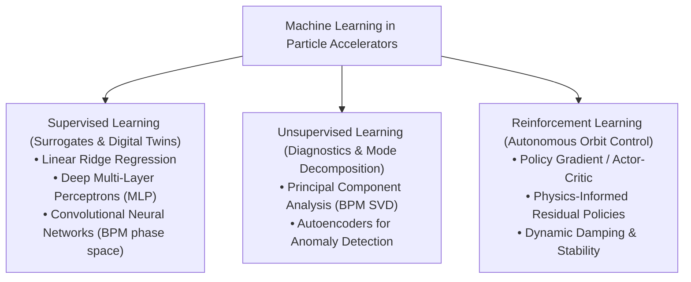
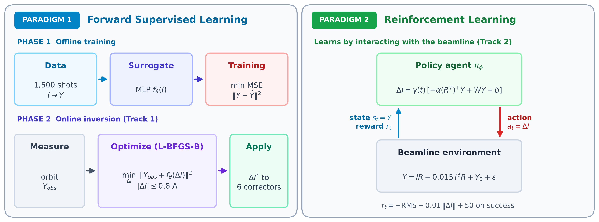
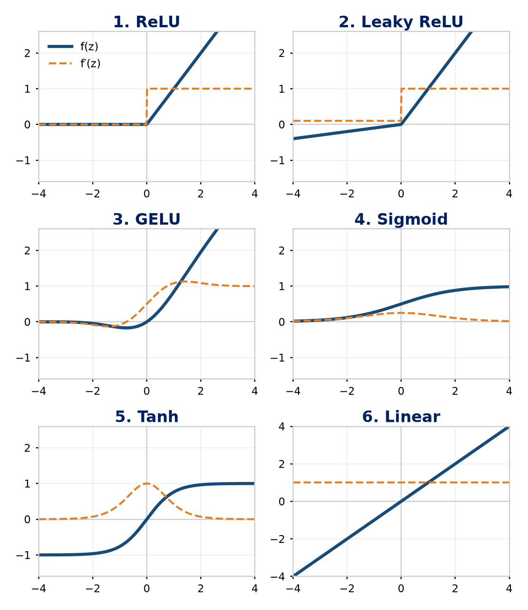
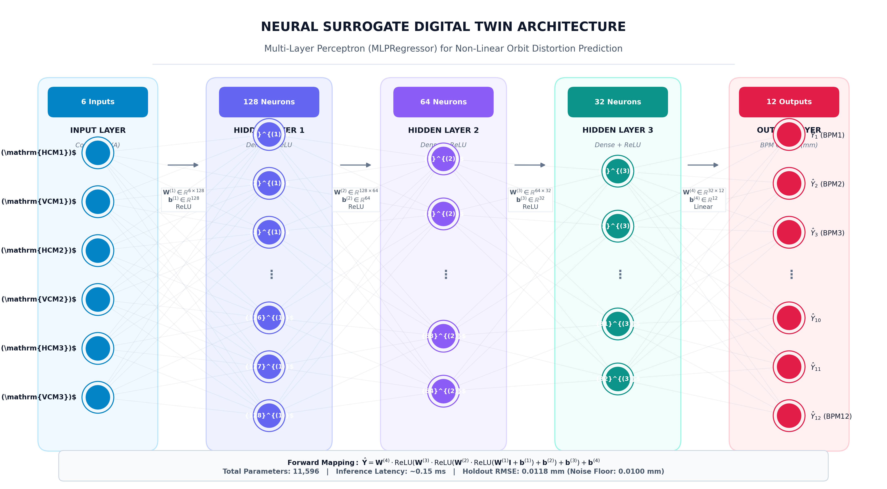
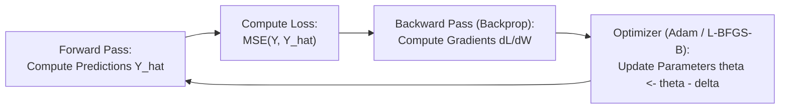
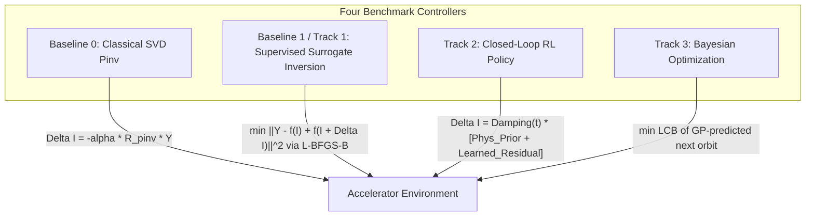

# Lecture 1: AI/ML Foundations and Closed-Loop Control for Particle Accelerators
## Physics Foundations, Neural Surrogates, Reinforcement Learning, and Bayesian Optimization

**Author:** Chong Shik Park, Ph.D.  
**Affiliation:**  
- Department of Accelerator Science, Korea University, Sejong 30019, Republic of Korea  
- Center for Accelerator Research, Korea University, Sejong 30019, Republic of Korea  
**Date:** November 19, 2026  
**Target Audience:** Graduate Students & Early-Career Postdoctoral Researchers in Accelerator Physics and Engineering  

---

## 🎯 Executive Lecture Abstract

Modern particle accelerator facilities—such as synchrotron light sources, free-electron lasers (FELs), spallation neutron sources, hadron linacs, and high-energy colliders—operate with thousands of coupled parameters under strict sub-micron beam stability tolerances. Traditional beam-based feedback and numerical simulation codes face severe computational bottlenecks in real-time non-linear regimes.

This lecture provides the rigorous theoretical and computational bridge between **accelerator beam physics** and **machine learning techniques**—spanning **supervised neural surrogates**, **closed-loop reinforcement learning**, and **probabilistic Bayesian optimization**—focusing directly on the physical system and control paradigms implemented in the afternoon **Beam Orbit Alignment Mini-Hackathon**:
1. How transverse betatron oscillations and quadrupole optics generate the linear **Orbit Response Matrix (ORM)**.
2. The physical origins of non-linearities: magnetic core saturation, misalignment drift, and diagnostic noise.
3. Foundational principles of **Machine Learning & Deep Neural Networks**: artificial neurons, layer anatomy, activation functions (ReLU), loss functions (MSE, RMSE), optimization algorithms (Adam), and validation partitioning (train/validation/test).
4. Formulating and training **Neural Surrogate Digital Twins** (`MLPRegressor`) from tracking simulations to capture cubic core saturation.
5. Transitioning from forward prediction to closed-loop orbit correction:
   - Classical Moore-Penrose Pseudo-Inverse (SVD),
   - Model-based bounded optimization (`L-BFGS-B`),
   - Closed-loop Reinforcement Learning (RL) policies with physics-informed priors and adaptive damping,
   - Sample-efficient Bayesian Optimization using Gaussian Processes and Lower Confidence Bound (LCB) acquisition.

<div style="page-break-after: always;"></div>

---

## 📑 Table of Contents

1. [Introduction: AI Applications in Modern Particle Accelerators](#1-introduction-ai-applications-in-modern-particle-accelerators)
2. [Motivation & Accelerator Physics Foundations](#2-motivation--accelerator-physics-foundations)
3. [Machine Learning Fundamentals & Neural Surrogate Modeling](#3-machine-learning-fundamentals--neural-surrogate-modeling)
4. [Closed-Loop Control Paradigms](#4-closed-loop-control-paradigms)
5. [Mini-Hackathon Problem Formulation & Gymnasium Contract](#5-mini-hackathon-problem-formulation--gymnasium-contract)
6. [Summary & Q&A](#6-summary--qa)

<div style="page-break-after: always;"></div>

---

## 1. Introduction: AI Applications in Modern Particle Accelerators

Over the past decade, Artificial Intelligence (AI) and Machine Learning (ML) have evolved from experimental proofs-of-concept into mission-critical operational tools across modern particle accelerator facilities, including synchrotron light sources, free-electron lasers (XFELs), spallation neutron sources, high-intensity hadron linacs, and energy-frontier colliders ([Edelen et al., 2018](https://arxiv.org/abs/1811.03172)). Modern accelerators operate with thousands of distributed, non-linearly coupled magnet actuators, radiofrequency (RF) accelerating stations, and high-rate diagnostic monitors under stringent beam quality and stability demands.

The landscape of AI applications in particle accelerators is broadly categorized into five foundational pillars:

1. **Surrogate Modeling & Fast Digital Twins ([Edelen et al., 2016](https://doi.org/10.1109/TNS.2016.2543203), [Edelen et al., 2018](https://arxiv.org/abs/1811.03172)):**  
   High-fidelity numerical particle tracking codes (such as `ELEGANT`, `MAD-X`, and `OPAL`) simulate complex beam dynamics, space-charge forces, and collective effects, but require minutes to hours per run. Deep neural networks (Multi-Layer Perceptrons, Convolutional Networks, and Physics-Informed Neural Networks) learn fast surrogate representations capable of evaluating beamline outcomes in sub-millisecond execution times. These ultra-fast surrogates serve as digital twins for real-time model-predictive control, online trajectory correction, and rapid parametric sensitivity analysis.

2. **Multi-Objective Autonomous Optimization & Tuning ([Roussel et al., 2021](https://doi.org/10.1038/s41467-021-25757-3), [Edelen et al., 2020](https://doi.org/10.1103/PhysRevAccelBeams.23.044601)):**  
   Commissioning and daily operations involve optimizing conflicting performance objectives—such as maximizing beam transmission and photon brightness while minimizing transverse emittance and beam halo. Bayesian Optimization (BO) with Gaussian Processes, combined with active learning and exploration-exploitation acquisition functions, enables sample-efficient multi-objective optimization directly on physical machines, converging in dozens of shots compared to thousands of iterations required by brute-force parameter scans.

3. **Virtual Diagnostics & Non-Destructive Phase Space Reconstruction ([Emma et al., 2018](https://doi.org/10.1103/PhysRevAccelBeams.21.112802)):**  
   Critical beam properties—such as 6D phase space, bunch slice emittance, and femtosecond current profiles—often require interceptive diagnostics (e.g., transverse deflection cavities, wire scanners, or screens) that disrupt or destroy the beam. Virtual diagnostics leverage supervised machine learning to accurately reconstruct unmeasured or destructive bunch characteristics shot-by-shot from non-invasive upstream RF probes, magnet currents, and Beam Position Monitor (BPM) signals.

4. **Anomaly Detection, Fault Classification & Machine Protection ([Tennant et al., 2020](https://doi.org/10.1103/PhysRevAccelBeams.23.114601)):**  
   Unscheduled beam downtime in multi-megawatt hadron linacs and synchrotron facilities incurs heavy scientific and operational costs. Unsupervised machine learning (autoencoders, isolation forests) continuously monitors archival and real-time telemetry to detect subtle precursor drift patterns, while deep sequence models predict high-voltage RF breakdowns, ion source dropouts, and superconducting cavity quenches milliseconds before catastrophic failure, triggering proactive mitigation and machine protection interlocks.

5. **Agentic AI & Autonomous Operation Workflows ([Hellert et al., 2025](https://arxiv.org/abs/2508.15066)):**  
   Moving beyond single-purpose neural networks, modern research explores autonomous agent architectures (such as *Osprey* and LLM-driven scientific agents). These systems integrate large language models with standardized Python control APIs, simulation engines, and diagnostic databases, enabling high-level natural language operational commands (e.g., "align the transport line orbit and optimize injection efficiency") to be autonomously planned, validated, and executed under strict domain guardrails.

---

## 2. Motivation & Accelerator Physics Foundations

### 2.1 The Operational Challenge in Modern Accelerators
In modern storage rings, linear accelerators (LINACs), and light sources, the beam trajectory must be stabilized to within a fraction of the transverse beam size—often **sub-micron or tens of micrometers** RMS.

Transverse orbit stability is equally vital in **hadron linacs** (high-intensity proton and heavy-ion linear accelerators). In modern multi-megawatt hadron machines, uncorrected beam trajectory offsets through accelerating RF cavities and focusing quadrupoles induce strong non-linear space-charge forces, emittance growth, and halo formation. Because high-intensity hadron beams carry enormous beam power, even minute fractional beam losses (exceeding $1\text{ W/m}$ or $10^{-5}$ of total current) induce severe structural radioactivation, prohibiting hands-on maintenance and risking superconducting cavity quenches or vacuum chamber damage.

Orbit distortions arise from multiple sources:
- **Slow Drifts:** Thermal expansion of girders, diurnal ambient temperature shifts, and ground motion.
- **Dynamic Jitter:** Mechanical vibration from cooling water pumps, cryocoolers, and power supply ripple.
- **High Actuator Coupling:** Deflecting a single dipole corrector causes betatron wave propagation across the entire transport line.


### 2.2 Transverse Beam Dynamics & Hill's Equation
Transverse particle motion along the longitudinal beam coordinate $s$ in a linear uncoupled lattice is governed by **Hill's Equation** ([Wiedemann, 2015](https://doi.org/10.1007/978-3-319-18317-6)):
$$\frac{d^2 x(s)}{ds^2} + K(s) x(s) = 0$$
where $K(s) = \frac{e}{p} \frac{\partial B_y(s)}{\partial x}$ represents the alternating quadrupole focusing strength ($K > 0$ for focusing `QF`, $K < 0$ for defocusing `QD`).

The general solution is a pseudo-harmonic **betatron oscillation**:
$$x(s) = \sqrt{\epsilon \beta(s)} \cos\left( \psi(s) + \phi_0 \right)$$
- $\beta(s)$: The Courant-Snyder beta function describing the transverse envelope of the beam.
- $\psi(s) = \int_0^s \frac{d\bar{s}}{\beta(\bar{s})}$: The betatron phase advance.
- $\nu = \frac{1}{2\pi} \oint \frac{ds}{\beta(s)}$: The betatron tune (total phase advance in units of $2\pi$).

### 2.3 Derivation of the Orbit Response Matrix (ORM)
When a localized angular deflection (kick) $\theta_i = \Delta x'_i = \frac{e B L}{p}$ is applied by dipole steering corrector $i$ at position $s_i$, the orbit shift observed by Beam Position Monitor (BPM) $j$ at position $s_j$ depends on the machine type. Rows of $\mathbf{R}$ are correctors and columns are BPMs, as in the simulator's `env.R`:

- **Single-pass transport line or linac** (the hackathon case): only BPMs downstream of the corrector see the kick, which propagates as a betatron oscillation:
  $$R_{ij} = \frac{\Delta x(s_j)}{\theta_i} = \begin{cases} \sqrt{\beta(s_i)\beta(s_j)}\, \sin\left( \psi(s_j) - \psi(s_i) \right) & (s_j > s_i) \\ 0 & (s_j \le s_i) \end{cases}$$
- **Circular ring:** the kick produces a periodic closed-orbit distortion seen at every BPM:
  $$R_{ij} = \frac{\sqrt{\beta(s_i)\beta(s_j)}}{2 \sin(\pi \nu)} \cos\left( |\psi(s_j) - \psi(s_i)| - \pi \nu \right)$$
- **Hackathon simplified optics model:** constant phase advance of $2\pi \cdot 0.18\text{ rad/m}$ and slowly decaying amplitude:
  $$R_{ij} = \frac{1.2\,\sin\big(2\pi \cdot 0.18\,(s_j - s_i)\big)}{1 + 0.05\,(s_j - s_i)}, \qquad (s_j > s_i)$$

For $N$ dipole steerers and $M$ BPMs, the linear response is encapsulated by the **Orbit Response Matrix (ORM)** $\mathbf{R} \in \mathbb{R}^{N \times M}$ ([Minty & Zimmermann, 2003](https://doi.org/10.1007/978-3-662-08581-3)). With the currents and the orbit written as row vectors:
$$\mathbf{Y}_{\text{linear}} = \mathbf{I} \cdot \mathbf{R}$$

### 2.4 The Mini-Hackathon Lattice Geometry
The hackathon environment models a 15-meter transport line:
- **12 Beam Position Monitors ($M = 12$):** Evenly distributed from $s = 1.0\text{ m}$ to $s = 15.0\text{ m}$.
- **6 Dipole Correctors ($N = 6$):** 3 Horizontal (`HCM1-3`) and 3 Vertical (`VCM1-3`) positioned between $s = 0.2\text{ m}$ and $s = 8.0\text{ m}$.
- **Quadrupole Doublets:** Alternating `QF` and `QD` magnets maintaining transverse envelope stability.
- **Hardware Current Limits:** Power supply limits $\mathbf{I} \in [-5.0\text{ A}, +5.0\text{ A}]$; single-step adjustment limits $\Delta \mathbf{I} \in [-0.8\text{ A}, +0.8\text{ A}]$.

```
0 m                                                                        15 m
 |===[HCM1]==[QF1]==[BPM1]==[VCM1]==[QD1]==[BPM2] ... [HCM3]==[QF3]==[BPM12]===> Beam Axis
```

### 2.5 Real-World Non-Linearities & Physical Imperfections
Ideal linear ORM assumes pure dipoles and noiseless diagnostics. In reality, accelerators exhibit:
1. **Magnetic Core Saturation:** High coil currents drive iron yokes into saturation, reducing effective kick efficiency. In our simulator:
   $$\mathbf{Y}_{\text{sat}} = - 0.015 \cdot (\mathbf{I}^3 \cdot \mathbf{R})$$
2. **Upstream Orbit Errors ($\mathbf{Y}_0$):** Steering and alignment errors upstream of the line produce an initial orbit distortion that the controller does not know in advance. The simulator models it as unknown steering kicks at all six corrector locations, $\mathbf{Y}_0 = \mathbf{a} \cdot \mathbf{R}$ with $a_k \sim \mathcal{U}(-2.5, 2.5)\text{ A}$ drawn for each episode seed, giving initial RMS errors of $0.93\text{ mm}$ to $3.59\text{ mm}$ on the 30 evaluation seeds. Because the distortion lies in the span of the corrector responses, a perfect controller can cancel it down to the sensor noise, but this needs total currents up to about $2.8\text{ A}$, where the cubic saturation softens the magnets by up to 12\%, and about 3 to 4 steps of at most $0.8\text{ A}$.
3. **BPM Sensor Noise:** Thermal and RF digitizer noise $\boldsymbol{\epsilon} \sim \mathcal{N}(0, \sigma^2)$, with $\sigma = 0.010\text{ mm}$ ($10\ \mu\text{m}$).

**Complete Physical Response Function:**
$$\mathbf{Y} = \mathbf{I} \cdot \mathbf{R} - 0.015 \cdot (\mathbf{I}^3 \cdot \mathbf{R}) + \mathbf{Y}_0 + \boldsymbol{\epsilon}$$

---

## 3. Machine Learning Fundamentals & Neural Surrogate Modeling

### 3.1 Machine Learning Taxonomy in Accelerators
Machine Learning (ML) algorithms automatically extract functional relationships from experimental or simulated data without explicit analytical programming. In accelerator physics, ML is organized into three major paradigms:
1. **Supervised Learning:** Learning a functional mapping $\mathbf{Y} = f(\mathbf{X})$ from paired inputs $\mathbf{X}$ (e.g., magnet currents) to targets $\mathbf{Y}$ (e.g., BPM offsets, beam emittance, photon flux). Used for **Surrogate Modeling / Digital Twins**.
2. **Unsupervised Learning:** Discovering latent structures, clustering, and dimensionality reduction in unlabeled data (e.g., Principal Component Analysis (PCA) on BPM histories for betatron mode decomposition, autoencoders for anomaly detection).
3. **Reinforcement Learning (RL):** Training an agent policy $\pi(a|s)$ via trial-and-error interaction within a Markov Decision Process (MDP) to maximize a scalar reward signal. Used for **Closed-Loop Autonomous Tuning**.



---

### 3.2 Foundational ML Paradigms: Forward Supervised Learning vs. Reinforcement Learning

To successfully design autonomous beam alignment systems, it is essential to understand the fundamental distinction between **Forward Supervised Learning** (learning a digital twin of the accelerator to be inverted) and **Reinforcement Learning** (learning a closed-loop policy agent that directly interacts with the machine).



*The three learning paradigms behind the challenge tracks. All three act on the measured orbit at every step; they differ in what is learned and when. Bayesian optimization (Track 3) is covered in Section 4.4.*

#### 3.2.1 Forward Supervised Learning: Surrogate Digital Twin & Online Inversion (Track 1)
In Forward Supervised Learning, the algorithm learns an input-to-output mapping from static, pre-collected datasets without directly steering the physical machine during training:
1. **Offline Training Phase:** 
   - We sample $N$ random corrector current vectors $\mathbf{I} \in \mathbb{R}^6$ (e.g., $N = 1,500$ shots over $[-3.0\text{ A}, +3.0\text{ A}]$) and pass them through high-fidelity tracking simulations or physical machine excitation steps.
   - For each input $\mathbf{I}$, the 12 Beam Position Monitor (BPM) transverse displacements $\mathbf{Y} \in \mathbb{R}^{12}$ are recorded, forming a supervised dataset $\mathcal{D} = \{(\mathbf{I}^{(i)}, \mathbf{Y}^{(i)})\}_{i=1}^N$.
   - A deep neural network (e.g. Multi-Layer Perceptron $f_{\boldsymbol{\theta}}$) is trained to minimize the Mean Squared Error (MSE) loss between its prediction $\hat{\mathbf{Y}} = f_{\boldsymbol{\theta}}(\mathbf{I})$ and the true readings $\mathbf{Y}$:
     $$\mathcal{L}_{\text{MSE}}(\boldsymbol{\theta}) = \frac{1}{N} \sum_{i=1}^N \left\| \mathbf{Y}^{(i)} - f_{\boldsymbol{\theta}}(\mathbf{I}^{(i)}) \right\|_2^2$$
   - Through gradient backpropagation and the Adam optimizer, the neural surrogate fits the non-linear magnetic core saturation $B(I) \approx I - 0.015 \cdot I^3$ down to the $0.010\text{ mm}$ sensor noise floor.
2. **Online Inversion for Beam Alignment:**
   - In operations, the trained surrogate $f_{\boldsymbol{\theta}}$ acts as an ultra-fast **digital twin**. Given an observed distorted orbit $\mathbf{Y}_{\text{obs}}$, we find the corrective kick $\Delta \mathbf{I}^*$ by numerically inverting the surrogate via bounded optimization (e.g., SciPy `L-BFGS-B`):
     $$\Delta \mathbf{I}^* = \arg\min_{\Delta \mathbf{I}} \left\| \mathbf{Y}_{\text{obs}} - f_{\boldsymbol{\theta}}(\mathbf{I}) + f_{\boldsymbol{\theta}}(\mathbf{I} + \Delta \mathbf{I}) \right\|_2^2 + \lambda \|\Delta \mathbf{I}\|_2^2$$
     where $\mathbf{I}$ is the present total corrector current. The applied kick is limited to $\Delta \mathbf{I} \in [-0.8\text{ A}, +0.8\text{ A}]^6$ per step.
   - **Key Advantage:** Convergence in about 4 steps, close to the limit set by the $0.8\text{ A}$ step size, because the surrogate anticipates magnetic saturation.

#### 3.2.2 Reinforcement Learning: Closed-Loop Policy Control (Track 2)
In Reinforcement Learning (RL), the system is formulated as a sequential **Markov Decision Process (MDP)** $(\mathcal{S}, \mathcal{A}, \mathcal{P}, \mathcal{R}, \gamma)$, where an agent policy learns through continuous trial-and-error interaction:
1. **State Space ($\mathcal{S}$):** Current transverse beam displacements at diagnostic stations, $\mathbf{s}_t = \mathbf{Y}_t \in \mathbb{R}^{12}$, bounded in $[-10.0\text{ mm}, +10.0\text{ mm}]$.
2. **Action Space ($\mathcal{A}$):** Corrective magnet current adjustments, $\mathbf{a}_t = \Delta \mathbf{I}_t \in \mathbb{R}^6$, constrained by hardware delta limits $[-0.8\text{ A}, +0.8\text{ A}]$.
3. **Environment Transition Dynamics ($\mathcal{P}$):** Physical beamline transport response, including linear betatron motion, non-linear saturation, the initial steering-error distortion $\mathbf{Y}_0$, and sensor noise $\boldsymbol{\epsilon}$:
   $$\mathbf{I}_{t+1} = \text{clip}(\mathbf{I}_t + \mathbf{a}_t, -5.0, +5.0)\text{ A}, \quad \mathbf{s}_{t+1} = \mathbf{I}_{t+1} \cdot \mathbf{R} - 0.015 \cdot (\mathbf{I}_{t+1}^3 \cdot \mathbf{R}) + \mathbf{Y}_0 + \boldsymbol{\epsilon}$$
4. **Reward Signal ($\mathcal{R}$):** Scalar performance feedback evaluated at each interaction step:
   $$r_t = - w_{\text{rms}} \cdot \text{RMS}_{t+1} - w_{\text{act}} \cdot \|\mathbf{a}_t\|_2^2 - c_{\text{step}} + (B_{\text{success}} \text{ if terminated else } 0.0)$$
   where $w_{\text{rms}}$ penalizes beam offset, $w_{\text{act}}$ penalizes large kick effort, $c_{\text{step}}$ penalizes elapsed control steps, and $B_{\text{success}} = 50.0$ rewards achieving $\text{RMS} < 0.030\text{ mm}$.
5. **Policy Architecture & Damping:** Rather than learning from scratch, high-performance accelerator RL policies leverage **physics-informed priors** (such as Moore-Penrose pseudo-inverse of ORM) augmented with learned neural residuals and dynamic step damping:
   $$\Delta \mathbf{I}_t = \gamma(t) \cdot \left[ - \alpha (\mathbf{R}^T)^\dagger \mathbf{Y}_t + \mathbf{W}_{\text{learned}} \mathbf{Y}_t + \mathbf{b} \right], \quad \gamma(t) = \frac{1.0}{1.0 + 0.03 \cdot t}$$
   - **Key Advantage:** Very low latency (about $0.01\text{ ms}$ per step for the reference agent, against about $27\text{ ms}$ for per-step surrogate inversion) with no iterative optimization in the loop.

#### 3.2.3 Comparative Architectural Analysis: Forward SL vs. Closed-Loop RL

| Dimension | Forward Supervised Learning (Track 1) | Reinforcement Learning (Track 2) |
| :--- | :--- | :--- |
| **Primary Goal** | Accurate physical predictive twin ($\hat{\mathbf{Y}} = f_{\boldsymbol{\theta}}(\mathbf{I})$) | Optimal closed-loop action policy ($\mathbf{a}_t = \pi_{\boldsymbol{\phi}}(\mathbf{s}_t)$) |
| **Data Collection** | Offline passive sampling across parameter grid | Online interactive rollouts in environment |
| **Learning Signal** | Vector ground-truth labels $\mathbf{Y}_{\text{true}}$ (BPM vectors) | Scalar reward $r_t$ (Alignment quality + energy penalty) |
| **Loss / Objective** | Minimize MSE / RMSE prediction error | Maximize expected cumulative return $\mathbb{E}[\sum \gamma^t r_t]$ |
| **Control Mechanism** | Forward twin evaluation + SciPy `L-BFGS-B` solver | Direct feedback policy evaluation in single matrix pass |
| **Execution Latency** | About $27\text{ ms}$ per step (iterative optimization, hundreds of surrogate calls) | About $0.01\text{ ms}$ per step (one matrix-vector product) |
| **Sample Efficiency** | High (1,500 shots trains complete non-linear model) | Moderate to high (when initialized with physics priors) |
| **Failure Handling** | Constrained explicitly by optimizer bounds | Constrained by hardware action clipping & damping schedule |

---

### 3.3 Model Training Terminology & Operational Definitions

To systematically design, train, and diagnose neural network models in accelerator physics, engineers must master the standard mathematical and operational terminology of model training:

1. **Weights ($\mathbf{W}$) & Biases ($\mathbf{b}$):**
   - **Weights ($\mathbf{W} \in \mathbb{R}^{m \times n}$):** Trainable synaptic scaling multipliers that weight the contribution of input features or upstream activations. In beam physics surrogates, weights encode the effective transport coupling between magnetic fields and trajectory deflections.
   - **Biases ($\mathbf{b} \in \mathbb{R}^m$):** Trainable affine translation vectors that shift the activation threshold of a neuron independently of the inputs, allowing the network to represent non-zero baselines (e.g. unsteered closed-orbit distortion offsets $\mathbf{Y}_0$).

2. **Activation Functions ($\sigma(z)$) and their Four Essential Operational Roles:**
   An activation function $\sigma: \mathbb{R} \to \mathbb{R}$ is a non-linear operator applied element-wise to pre-activation affine sums $z = \mathbf{w}^T \mathbf{x} + b$. In accelerator surrogate modeling, activation functions fulfill four critical roles:
   - **Role 1: Breaking Linearity (Preventing Model Collapse):** Without non-linear activations, stacking $L$ sequential dense layers mathematically collapses into a single matrix product $\mathbf{W}_{\text{eff}} = \mathbf{W}^{(L)} \cdots \mathbf{W}^{(1)}$, rendering a deep network no more expressive than a linear Orbit Response Matrix (ORM).
   - **Role 2: Universal Approximation of Non-Linear Physical Dynamics:** By introducing non-linearities, neural networks become universal function approximators (Hornik et al., 1989), allowing them to capture non-linear accelerator phenomena such as iron-core saturation $B(I) \propto I - 0.015 I^3$, sextupole fields, and chromatic aberrations.
   - **Role 3: Gating Backpropagation Gradients:** The derivative $\sigma'(z)$ acts as a transmission gate for error gradients during backpropagation. Non-saturating activations (such as ReLU with $\sigma'(z) = 1$ for $z > 0$) prevent gradients from vanishing across deep layers, ensuring stable gradient descent.
   - **Role 4: Enforcing Physical Output Bounds:** Selecting the appropriate activation function ensures output values conform to physical reality. While intermediate hidden layers require non-linearities, output regression layers predicting unconstrained spatial coordinates ($mm$) must strictly use linear identity activations to avoid artificial truncation.

3. **Loss Functions ($\mathcal{L}$) and Loss Rates:**
   - **Loss Function ($\mathcal{L}(\boldsymbol{\theta})$):** A scalar objective measuring the discrepancy between model predictions $\hat{\mathbf{Y}} = f_{\boldsymbol{\theta}}(\mathbf{X})$ and physical ground truth $\mathbf{Y}$. In regression surrogates, Mean Squared Error (MSE) is standard:
     $$\mathcal{L}_{\text{MSE}}(\boldsymbol{\theta}) = \frac{1}{N} \sum_{i=1}^N \|\mathbf{Y}^{(i)} - f_{\boldsymbol{\theta}}(\mathbf{X}^{(i)})\|_2^2$$
   - **Loss Rate & Convergence:** The derivative or epoch-by-epoch change in loss $\Delta \mathcal{L} / \Delta \text{epoch}$. During early training, the loss rate is steep as linear ORM components are fitted; in late epochs, the loss rate flattens as subtle non-linearities are resolved down to the diagnostic noise floor ($\sigma = 10\ \mu\text{m}$).

4. **Gradients ($\nabla_{\boldsymbol{\theta}}\mathcal{L}$) and Backpropagation:**
   - The gradient vector $\nabla_{\boldsymbol{\theta}}\mathcal{L} = \left[\frac{\partial \mathcal{L}}{\partial \mathbf{W}^{(1)}}, \frac{\partial \mathcal{L}}{\partial \mathbf{b}^{(1)}}, \dots, \frac{\partial \mathcal{L}}{\partial \mathbf{W}^{(L)}}, \frac{\partial \mathcal{L}}{\partial \mathbf{b}^{(L)}}\right]^T$ points in the direction of steepest increase in loss.
   - **Backpropagation** applies the multivariable chain rule recursively from the output layer back to the input layer, computing exact parameter gradients in $O(|\boldsymbol{\theta}|)$ time rather than costly numerical finite differences.

5. **Epoch, Batch Size ($B$), and Step / Iteration:**
   - **Epoch:** Exactly one complete pass through the entire training dataset ($N$ shots).
   - **Batch Size ($B$):** The number of training samples processed in parallel before performing a single parameter update. Full-batch ($B=N$) computes the exact gradient over the whole dataset; mini-batch ($B \in [32, 128]$) introduces stochastic fluctuations that help escape shallow saddle points.
   - **Step / Iteration:** A single gradient evaluation and parameter update $\boldsymbol{\theta} \leftarrow \boldsymbol{\theta} - \Delta \boldsymbol{\theta}$. An epoch consists of $\lceil N / B \rceil$ steps.

6. **Learning Rate ($\eta$) & Optimization Schedules:**
   - The scalar hyperparameter scaling the parameter update step: $\boldsymbol{\theta}_{t+1} = \boldsymbol{\theta}_t - \eta \cdot \mathbf{g}_t$.
   - An excessively high learning rate ($\eta > 0.05$) causes numerical divergence and oscillatory destabilization. An excessively low learning rate ($\eta < 10^{-5}$) stalls convergence. Learning rate schedulers (e.g. cosine decay or ReduceLROnPlateau) dynamically reduce $\eta$ as the model approaches optimal convergence.

7. **Regularization ($L_2$ Weight Decay, Early Stopping):**
   - **$L_2$ Regularization (Weight Decay $\alpha$):** Adds an explicit penalty on weight magnitudes to the loss: $\mathcal{L}_{\text{total}} = \mathcal{L}_{\text{MSE}} + \frac{1}{2}\alpha \|\mathbf{W}\|_2^2$. This suppresses overfitting to Gaussian diagnostic jitter ($\boldsymbol{\epsilon} \sim 10\ \mu\text{m}$) by preventing runaway weight values.
   - **Early Stopping:** Monitors the validation loss on a separate holdout split during training. When validation loss ceases to decrease for a designated patience window, training terminates immediately, preserving the model state with the highest generalization fidelity.

8. **Generalization, Overfitting vs. Underfitting:**
   - **Underfitting (High Bias):** The model architecture lacks capacity to represent the true physics (e.g., a purely linear matrix attempting to fit iron-core saturation). Both training and test errors remain high.
   - **Overfitting (High Variance):** The network has excessive capacity and memorizes random sensor noise rather than underlying optics laws. Training error continues to plunge while validation error escalates.
   - **Generalization:** The capability of the trained surrogate to accurately predict beam orbits on novel, unseen corrector configurations.

---

### 3.4 Activation Functions Catalog: Mathematics, Gradients, and Selection

The choice of activation function directly determines the non-linear expressive capacity and training stability of accelerator neural networks:



*Six common activation functions $f(z)$ (solid) and their gradients $f'(z)$ (dashed). Note the vanishing gradients of Sigmoid and Tanh for large $|z|$, and the constant gradient of ReLU for $z > 0$.*

1. **Rectified Linear Unit (ReLU):**
   $$f(z) = \max(0, z), \qquad f'(z) = \begin{cases} 1 & \text{if } z > 0 \\ 0 & \text{if } z < 0 \end{cases}$$
   - **Advantages:** Gradient is strictly 1.0 for positive activations, completely eliminating the vanishing gradient problem. Evaluated via a single branch comparison without transcendental functions.
   - **Vulnerability:** "Dying ReLU" phenomenon—if a neuron receives inputs that push its pre-activation permanently negative ($z < 0$), its output and gradient remain zero forever, inactivating that parameter permanently.

2. **Leaky ReLU:**
   $$f(z) = \max(\alpha z, z), \quad \alpha \approx 0.01, \qquad f'(z) = \begin{cases} 1 & \text{if } z > 0 \\ \alpha & \text{if } z \le 0 \end{cases}$$
   - **Role:** Guarantees a small non-zero slope ($\alpha$) for negative arguments, allowing "dead" neurons to recover during backpropagation.

3. **Gaussian Error Linear Unit (GELU):**
   $$f(z) = z \cdot \Phi(z) = z \cdot \frac{1}{2}\left[1 + \text{erf}\left(\frac{z}{\sqrt{2}}\right)\right]$$
   - **Role:** Smooth probabilistic gating based on the standard normal cumulative distribution function $\Phi(z)$. Avoids hard non-differentiable corners at $z=0$, providing smooth curvature gradients. Standard in modern Transformer architectures.

4. **Sigmoid:**
   $$\sigma(z) = \frac{1}{1 + e^{-z}}, \qquad \sigma'(z) = \sigma(z)(1 - \sigma(z))$$
   - **Role:** Smooth mapping bounding outputs to $(0, 1)$. Widely used for probabilistic classification or gating.
   - **Limitation:** For $|z| > 4$, the gradient vanishes ($\sigma'(z) \to 0$), paralyzing gradient descent in deep multi-layer networks.

5. **Hyperbolic Tangent ($\tanh$):**
   $$\tanh(z) = \frac{e^z - e^{-z}}{e^z + e^{-z}}, \qquad \tanh'(z) = 1 - \tanh^2(z)$$
   - **Role:** Zero-centered mapping bounded in $(-1, 1)$. Stronger gradients around $z=0$ than Sigmoid. Near the origin, $\tanh(z) \approx z$, making it highly effective for modeling smooth perturbations around a linear operating point.

6. **Linear / Identity Activation:**
   $$f(z) = z, \qquad f'(z) = 1$$
   - **Mandatory Output Constraint:** Physical diagnostic measurements (such as beam transverse positions $Y \in \mathbb{R}$ in $mm$) are unbounded continuous physical quantities. Output layers must strictly employ linear activations. Placing a bounded activation function (like Sigmoid or Tanh) on the output layer would artificially clamp the predicted beam position to a narrow band, ruining model fidelity.

---

### 3.5 Worked Example: Neural Surrogate for a Particle Transfer Matrix

To bridge abstract deep learning concepts directly with accelerator beam physics, consider the canonical problem of surrogating a linear beamline section characterized by a particle transfer matrix.

#### 1. Classical Analytical Transfer Matrix Formulation
In linear beam optics, the transverse phase-space trajectory of a particle through a transport lattice from initial position $s_0$ to final diagnostic station $s_f$ is described by the $2 \times 2$ transfer matrix $\mathbf{M}$:

$$\begin{pmatrix} x_f \\ x'_f \end{pmatrix} = \mathbf{M} \begin{pmatrix} x_0 \\ x'_0 \end{pmatrix} = \begin{pmatrix} C(s) & S(s) \\ C'(s) & S'(s) \end{pmatrix} \begin{pmatrix} x_0 \\ x'_0 \end{pmatrix}$$

where $x$ is the transverse offset ($mm$), $x' = dx/ds$ is the transverse angle ($mrad$), $C(s)$ and $S(s)$ are the cosinelike and sinelike principal trajectories, and the determinant is strictly constrained by symplecticity (Liouville's theorem / conservation of phase-space area):

$$\det \mathbf{M} = C(s)S'(s) - S(s)C'(s) \equiv 1$$

Under unperturbed transport, a matched beam ellipse $\gamma x^2 + 2\alpha x x' + \beta x'^2 = \epsilon$ transforms into another ellipse of identical invariant area $\pi \epsilon$.

#### 2. Neural Network Surrogate Architecture
Instead of applying analytical matrix tracking, we construct a neural surrogate $f_{\boldsymbol{\theta}}: \mathbb{R}^2 \to \mathbb{R}^2$ that ingests initial particle coordinates $(x_0, x'_0)$ and predicts final coordinates $(\hat{x}_f, \hat{x}'_f)$:

```
           [ x_0  ] ──┐
  Input               ├──> [ Hidden Layer 1: 4 units, σ ] ──> [ Hidden Layer 2: 4 units, σ ] ──> [ Output: Linear ] ──> [ x_hat_f  ]
  Phase Space [ x'_0 ] ──┘                                                                                      [ x'_hat_f ]
```

$$\begin{pmatrix} \hat{x}_f \\ \hat{x}'_f \end{pmatrix} = f_{\boldsymbol{\theta}}\begin{pmatrix} x_0 \\ x'_0 \end{pmatrix} = \mathbf{W}^{(3)} \sigma\left( \mathbf{W}^{(2)} \sigma\left( \mathbf{W}^{(1)} \begin{pmatrix} x_0 \\ x'_0 \end{pmatrix} + \mathbf{b}^{(1)} \right) + \mathbf{b}^{(2)} \right) + \mathbf{b}^{(3)}$$

The network is trained over $N$ particle tracking pairs $\mathcal{D} = \{((x_0^{(i)}, x_0'^{(i)}), (x_f^{(i)}, x_f'^{(i)}))\}_{i=1}^N$ using Mean Squared Error loss:

$$\mathcal{L}_{\text{MSE}}(\boldsymbol{\theta}) = \frac{1}{N} \sum_{i=1}^N \left[ \left( x_f^{(i)} - \hat{x}_f^{(i)} \right)^2 + \left( x_f'^{(i)} - \hat{x}'_f^{(i)} \right)^2 \right]$$

#### 3. How Different Activation Functions Act on the Transfer Matrix Surrogate
The selection of the hidden activation function $\sigma(z)$ exerts a profound physical impact on phase-space geometry, symplecticity, and extrapolation:

1. **Linear / Identity Activation ($\sigma(z) = z$):**
   - **Mathematical Behavior:** Stacking linear layers mathematically collapses to:
     $$\mathbf{W}^{(3)}\mathbf{W}^{(2)}\mathbf{W}^{(1)}\mathbf{x} + \mathbf{b}_{\text{net}} \equiv \mathbf{M}_{\text{eff}}\mathbf{x} + \mathbf{b}_{\text{net}}$$
     The surrogate is mathematically identical to a linear matrix.
   - **Optics Impact:** If trained on symplectic data, the network learns an effective matrix $\mathbf{M}_{\text{eff}} \approx \mathbf{M}$ with $\det \mathbf{M}_{\text{eff}} \approx 1$. It preserves smooth phase space ellipses and extrapolates linearly to arbitrarily large beam amplitudes.
   - **Limitation:** Incapable of representing non-linear physical phenomena (e.g. sextupole kicks $\Delta x' = \frac{1}{2} k_2 L x^2$, chromatic aberrations, or magnetic core saturation).

2. **Rectified Linear Unit (ReLU: $\sigma(z) = \max(0, z)$):**
   - **Mathematical Behavior:** Partitions the 2D input phase space $(x_0, x'_0)$ into a patchwork of polyhedral facets separated by activation hyperplanes $\mathbf{w}_j^T \mathbf{x} + b_j = 0$. Within each facet, the mapping is strictly affine.
   - **Optics Impact:** Transforms smooth continuous phase-space ellipses into **faceted polygons with sharp slope kinks**. Second derivatives $d^2 x / d x_0^2$ are zero almost everywhere but undefined at facet boundaries.
   - **Symplecticity Breakdown:** Particles with large negative coordinates may land in regions where all neurons are inactive ($z < 0$). In this regime, the output collapses to $\mathbf{b}^{(3)}$ and the Jacobian determinant drops to $\det \mathbf{J} = 0$, completely destroying phase-space area conservation and violating Liouville's theorem.

3. **Hyperbolic Tangent ($\tanh: \sigma(z) = \tanh(z)$):**
   - **Mathematical Behavior:** A smooth, infinitely differentiable ($C^\infty$) sigmoid curve with Taylor expansion $\tanh(z) = z - \frac{1}{3}z^3 + \mathcal{O}(z^5)$.
   - **Optics Impact:** Near the beam core ($|x_0|, |x'_0| \ll 1$), $\tanh(z) \approx z$, so the network accurately reproduces the linear transfer matrix $\mathbf{M}$ and preserves elliptical phase space trajectories.
   - **Halo & Wing Distortion:** At large phase-space amplitudes (beam halo or large steering errors), the hidden neurons enter saturation ($\tanh(z) \to \pm 1$). The surrogate squashes the phase space into S-curves, shrinking the beam emittance ($\det \mathbf{J} \to 0$) and failing to extrapolate accurately beyond the training domain.

4. **Output Layer Requirement:**
   - The output layer must strictly use the **Linear / Identity** activation. Transverse particle offsets $x_f$ and angles $x'_f$ are continuous and unbounded. Imposing a bounded activation (such as Sigmoid or Tanh) on the final layer would clamp particle positions to an artificial aperture window, corrupting trajectory predictions.

---

### 3.6 Multi-Layer Perceptron (MLP) Anatomy: Layers & Information Flow
A **Multi-Layer Perceptron (MLP)** or deep feedforward neural network connects neurons in sequential layers, transforming low-dimensional corrector kicks into non-linear orbit distortions:



```
   INPUT LAYER                  HIDDEN LAYERS                   OUTPUT LAYER
    (Actuators)               (Feature Extraction)              (Diagnostics)
    
     [ I_1 ] ───────> ( Neuron 1 ) ───> ( Neuron 1 ) ───────> [ Y_1  (BPM1)  ]
     [ I_2 ] ───────> ( Neuron 2 ) ───> ( Neuron 2 ) ───────> [ Y_2  (BPM2)  ]
     [ I_3 ] ───────> ( Neuron 3 ) ───> ( Neuron 3 ) ───────> [ Y_3  (BPM3)  ]
     [ I_4 ] ───────>     ...                ...     ───────>    ...
     [ I_5 ] ───────> ( Neuron 128)───> ( Neuron 32 )───────> [ Y_11 (BPM11) ]
     [ I_6 ] ───────────────────────────────────────────────> [ Y_12 (BPM12) ]
     
     6 inputs                128 → 64 → 32                     12 outputs
    (Correctors)             Hidden Units                      (BPM Offsets)
```

1. **Input Layer ($\mathbb{R}^6$):** Receives raw physical actuator setpoints (the 6 corrector magnet currents $I_1, \dots, I_6$). No computation occurs here.
2. **Hidden Layers ($\mathbb{R}^{128} \rightarrow \mathbb{R}^{64} \rightarrow \mathbb{R}^{32}$):** Intermediate representation layers that progressively transform linear inputs into non-linear feature combinations. Each layer applies:
   $$\mathbf{h}^{(l)} = \text{ReLU}\left( \mathbf{W}^{(l)} \mathbf{h}^{(l-1)} + \mathbf{b}^{(l)} \right)$$
3. **Output Layer ($\mathbb{R}^{12}$):** Linear projection producing the predicted 12 BPM readings ($\hat{Y}_1, \dots, \hat{Y}_{12}$). A linear activation is used because beam displacements are continuous real values ($mm$).

---

### 3.7 Loss Functions, Loss Rates & Evaluation Metrics: MSE vs. RMSE

To train a neural network, we must quantify the error between network predictions $\hat{\mathbf{Y}}$ and physical ground truth observations $\mathbf{Y}$.

1. **Mean Squared Error (MSE) Loss Function:**
   $$\mathcal{L}_{\text{MSE}}(\boldsymbol{\theta}) = \frac{1}{N} \sum_{i=1}^N \sum_{j=1}^M \left( Y_{i,j} - \hat{Y}_{i,j}(\boldsymbol{\theta}) \right)^2$$
   - Differentiable everywhere, providing smooth gradients for optimization.
   - Quadratically penalizes large errors, forcing the network to eliminate large orbit deviations.
2. **Root Mean Squared Error (RMSE) Evaluation Metric:**
   $$\text{RMSE} = \sqrt{\mathcal{L}_{\text{MSE}}} = \sqrt{\frac{1}{N \cdot M} \sum_{i=1}^N \sum_{j=1}^M \left( Y_{i,j} - \hat{Y}_{i,j} \right)^2}$$
   - **Why RMSE is the universal metric in accelerator physics:**
     - **Physical interpretability:** Taking the square root restores the metric to the original units of measurement (**millimeters / microns**).
     - Directly corresponds to the standard definition of beam orbit RMS error: $\text{RMS} = \sqrt{\frac{1}{12}\sum Y_k^2}$.

---

### 3.8 Optimization Algorithms: From Gradient Descent to Adam and L-BFGS-B

The network parameters $\boldsymbol{\theta} = \{\mathbf{W}^{(l)}, \mathbf{b}^{(l)}\}$ are optimized by minimizing the loss function $\mathcal{L}(\boldsymbol{\theta})$ via **backpropagation** (chain rule computation of gradients $\nabla_{\boldsymbol{\theta}} \mathcal{L}$).



#### 1. Stochastic Gradient Descent (SGD) & Learning Rate ($\eta$):
$$\boldsymbol{\theta}_{t+1} = \boldsymbol{\theta}_t - \eta \cdot \mathbf{g}_t, \qquad \mathbf{g}_t = \nabla_{\boldsymbol{\theta}} \mathcal{L}(\boldsymbol{\theta}_t)$$
- $\eta$ is the **learning rate** (step size).
  - If $\eta$ is **too large**: loss oscillates wildly or diverges.
  - If $\eta$ is **too small**: training is exceedingly slow and risks getting trapped in shallow plateaus.
- *Limitation of pure SGD:* Struggles in anisotropic loss landscapes (ravines) common in coupled accelerator lattices where some corrector magnets have far stronger kicks than others.

#### 2. Momentum SGD:
$$\mathbf{v}_t = \gamma \mathbf{v}_{t-1} + \eta \mathbf{g}_t, \qquad \boldsymbol{\theta}_{t+1} = \boldsymbol{\theta}_t - \mathbf{v}_t$$
- Introduces physical momentum ($\gamma \approx 0.9$), dampening high-frequency oscillations across steep ravine walls and accelerating along gentle valleys.

#### 3. AdaGrad & RMSProp:
- **AdaGrad:** Scales learning rate inversely with historical squared gradients: $\boldsymbol{\theta}_{t+1} = \boldsymbol{\theta}_t - \frac{\eta}{\sqrt{\mathbf{G}_t} + \epsilon} \mathbf{g}_t$. However, $\mathbf{G}_t$ grows monotonically, causing premature learning freeze.
- **RMSProp:** Solves AdaGrad's freeze using an exponentially decaying average of squared gradients: $\mathbf{v}_t = \beta \mathbf{v}_{t-1} + (1 - \beta)\mathbf{g}_t^2$.

#### 4. The Adam Optimizer (Adaptive Moment Estimation):
In our challenge notebook, we configure `solver='adam'`. Adam combines the advantages of **Momentum** (smoothing gradients over time) and **RMSprop** (adapting individual learning rates for each parameter based on historical variance):

1. **First Moment Vector (Exponentially decaying gradient average):**
   $$\mathbf{m}_t = \beta_1 \mathbf{m}_{t-1} + (1 - \beta_1) \mathbf{g}_t \quad (\beta_1 \approx 0.9)$$
2. **Second Moment Vector (Exponentially decaying squared gradient average):**
   $$\mathbf{v}_t = \beta_2 \mathbf{v}_{t-1} + (1 - \beta_2) \mathbf{g}_t^2 \quad (\beta_2 \approx 0.999)$$
3. **Bias Corrections:**
   $$\hat{\mathbf{m}}_t = \frac{\mathbf{m}_t}{1 - \beta_1^t}, \quad \hat{\mathbf{v}}_t = \frac{\mathbf{v}_t}{1 - \beta_2^t}$$
4. **Parameter Update Rule:**
   $$\boldsymbol{\theta}_{t+1} = \boldsymbol{\theta}_t - \frac{\eta}{\sqrt{\hat{\mathbf{v}}_t} + \epsilon} \hat{\mathbf{m}}_t$$
- **Why Adam is the usual default:** It scales each parameter's step by its own gradient history, so it needs little tuning and works with mini-batches on large datasets.
- **Caveat for this challenge:** With only 1,200 smooth, low-noise training shots, the default Adam run stops after about 85 epochs at a test RMSE of $0.109\text{ mm}$. A full-batch quasi-Newton solver (`solver='lbfgs'`) with `tanh` activations reaches $0.012\text{ mm}$ on the same data (Section 3.11).

#### 5. AdamW (Decoupled Weight Decay):
Unlike standard Adam where $L_2$ penalties are mixed into moment estimators, AdamW decouples weight decay: $\boldsymbol{\theta}_{t+1} = \boldsymbol{\theta}_t - \eta \lambda \boldsymbol{\theta}_t - \frac{\eta}{\sqrt{\hat{\mathbf{v}}_t} + \epsilon} \hat{\mathbf{m}}_t$. This yields superior holdout generalization.

#### 6. L-BFGS-B (Limited-Memory BFGS with Box Constraints):
A quasi-Newton second-order method that approximates the inverse Hessian $\mathbf{H}^{-1}$ from recent gradient histories without storing full matrices. In accelerator closed-loop control (Baseline 1 and Track 3), `L-BFGS-B` inverts the non-linear surrogate at every step: the six-dimensional problem is smooth and box-constrained, which suits a quasi-Newton method. The reference controllers search within $\pm 5\text{ A}$ and then clip the kick to the $[-0.8\text{ A}, +0.8\text{ A}]$ step limit.

---

### 3.9 Specialized Neural Architectures in Accelerators: Beyond Plain MLPs

While standard Multi-Layer Perceptrons (MLPs) serve as effective general-purpose regression digital twins for low-dimensional static mappings, accelerator physics and diagnostics frequently present challenges that violate the core assumptions of plain feedforward networks:
1. **Conservation Laws:** Physical conservation principles (symplectic phase-space area preservation $\det\mathbf{J} \equiv 1$, energy conservation, Maxwell's equations) are not inherently guaranteed by MLPs, causing unphysical trajectory drift in data-sparse operating regimes.
2. **Temporal Dynamics & Memory:** Dynamic accelerator phenomena exhibit non-Markovian memory, temporal eddy current lag, and magnetic iron-core hysteresis that static feedforward networks cannot represent.
3. **High-Dimensional Spatial Structures:** 2D/3D diagnostic arrays (such as beam profile imaging screens and magnet field maps) require spatial translation equivariance and multiscale localization rather than parameter-heavy dense projections.

To address these domains, accelerator AI practitioners deploy specialized deep learning topologies:

#### 1. Physics-Informed Neural Networks (PINNs)
- **Mathematical Mechanism:** Embeds known governing differential equations (ODEs/PDEs, such as Hill's equation $x'' + K(s)x = 0$ or Poisson's space-charge equation $\nabla^2 \phi = -\rho / \epsilon_0$) directly into the training loss:
  $$\mathcal{L}_{\text{PINN}}(\boldsymbol{\theta}) = \mathcal{L}_{\text{data}}(\boldsymbol{\theta}) + \lambda_{\text{phys}} \mathcal{L}_{\text{physics}}(\boldsymbol{\theta}) = \frac{1}{N} \sum_{i=1}^N \|\mathbf{y}_i - f_{\boldsymbol{\theta}}(\mathbf{x}_i)\|^2 + \frac{\lambda_{\text{phys}}}{M} \sum_{j=1}^M \|\mathcal{D}[f_{\boldsymbol{\theta}}](\mathbf{x}_j)\|^2$$
  where differential operators $\mathcal{D}$ are evaluated via exact automatic differentiation (autograd).
- **Why Beyond Plain MLP:** Standard MLPs act as purely empirical black-box interpolators, requiring massive datasets and failing unphysically when extrapolating outside the calibration envelope. PINNs enforce physical conservation principles ($\det \mathbf{J} \equiv 1$, energy conservation), regularizing network weights and ensuring valid physical predictions even in data-sparse lattice sections.
- **Accelerator Applications:** Space-charge potential solvers, beam envelope tracking, and trajectory prediction across unmonitored lattice drift sections lacking BPMs.

#### 2. Physics-Guided Recurrent Neural Networks (PRNN / RNN / LSTM)
- **Mathematical Mechanism:** Sequential state transitions with internal dynamic recurrence memory:
  $$\mathbf{h}_t = \sigma(\mathbf{W}_h \mathbf{h}_{t-1} + \mathbf{W}_x \mathbf{x}_t + \mathbf{b}_h), \quad \hat{\mathbf{y}}_t = \mathbf{W}_y \mathbf{h}_t + \mathbf{b}_y$$
  augmented with physics inductive biases (e.g. magnetic hysteresis models, thermal delay constants, RF cavity decay laws).
- **Why Beyond Plain MLP:** MLPs assume independent static inputs; PRNNs model non-Markovian memory, temporal lags, and hysteretic state dependence.
- **Accelerator Applications:** Magnetic iron-core hysteresis tracking in cycling magnets, superconducting RF cavity decay and quenching precursor detection, and time-series beam jitter forecasting.

#### 3. Variational Autoencoders (VAEs)
- **Mathematical Mechanism:** Probabilistic encoder-decoder mapping inputs to a continuous latent Gaussian distribution $\mathbf{z} \sim \mathcal{N}(\boldsymbol{\mu}_{\mathbf{z}}, \boldsymbol{\Sigma}_{\mathbf{z}})$, trained by maximizing the Evidence Lower Bound (ELBO):
  $$\mathcal{L}_{\text{ELBO}}(\boldsymbol{\theta}, \boldsymbol{\phi}) = \mathbb{E}_{q_{\boldsymbol{\phi}}(\mathbf{z}|\mathbf{x})}\left[ \log p_{\boldsymbol{\theta}}(\mathbf{x}|\mathbf{z}) \right] - D_{\text{KL}}\left( q_{\boldsymbol{\phi}}(\mathbf{z}|\mathbf{x}) \,\|\, p(\mathbf{z}) \right)$$
- **Why Beyond Plain MLP:** Learns smooth, continuous, probabilistic latent manifolds rather than deterministic black-box point mappings.
- **Accelerator Applications:** 6D particle bunch phase-space compression, unsupervised anomaly detection (identifying abnormal beam loss spike precursors or machine trips), and synthetic generative beam diagnostics.

#### 4. Convolutional Encoder-Decoders (U-Net & CNNs)
- **Mathematical Mechanism:** Fully convolutional architecture featuring a contracting feature extraction path paired with a symmetric expanding localization path, bridged by multiscale cross-layer skip connections:
  $$\mathbf{x}_{\text{dec}}^{(l)} = \text{Conv}\left( \text{Upsample}\left(\mathbf{x}_{\text{dec}}^{(l+1)}\right) \;\oplus\; \mathbf{x}_{\text{enc}}^{(l)} \right)$$
- **Why Beyond Plain MLP:** Exploits 2D/3D spatial translation equivariance; retains high-resolution local details while capturing global topological context, avoiding the parameter explosion of dense layers.
- **Accelerator Applications:** Transverse beam profile reconstruction from YAG/OTR screen diagnostic cameras, transverse halo segmentation, phase-space tomography, and 2D/3D magnet fringe field map interpolation.

| Architecture | Core Mathematical Mechanism | Why Beyond Plain MLP | Key Accelerator Use Cases |
| :--- | :--- | :--- | :--- |
| **PINN**<br>*(Physics-Informed)* | ODE/PDE residual in loss: $\mathcal{L}_{\text{data}} + \lambda_{\text{phys}}\|\mathcal{D}[f]\|^2$ via autograd | Enforces physical conservation ($\det\mathbf{J}\equiv 1$, energy) in data-sparse domains | Space-charge Poisson solvers, envelope equations, unmonitored drift prediction |
| **PRNN / RNN**<br>*(Physics-Guided Recurrent)* | Dynamic recurrent hidden state $\mathbf{h}_t = \sigma(\mathbf{W}_h \mathbf{h}_{t-1} + \dots)$ + physical delay biases | Models non-Markovian memory, temporal eddy current lags, and state dependence | Magnetic hysteresis tracking during cycling, superconducting RF cavity decay, jitter forecasting |
| **VAE**<br>*(Variational Autoencoder)* | Probabilistic latent space $\mathbf{z}\sim\mathcal{N}(\boldsymbol{\mu},\boldsymbol{\Sigma})$ via ELBO optimization | Unsupervised generative density modeling; continuous manifold representation | 6D particle bunch phase-space compression, unsupervised trip/anomaly detection, virtual diagnostics |
| **U-Net / CNN**<br>*(Convolutional Encoder-Decoder)* | Multiscale contracting & expanding paths with cross-layer skip connections | Exploits spatial translation equivariance; retains fine pixel details with global context | Transverse beam profile camera reconstruction (YAG/OTR), halo segmentation, 3D field map interpolation |

---

### 3.10 Rigorous Dataset Partitioning: Train, Validation, and Test (Holdout) Splits

A neural network with 11,628 parameters can easily memorize random noise if not evaluated correctly. We enforce strict data partitioning:

```
Total Offline Experimental Dataset (1,500 Simulation Shots)
┌────────────────────────────────────────────────────────┬───────────────────────────┐
│              TRAINING SET (80%, 1,200 shots)           │ TEST / HOLDOUT (20%, 300) │
│   Used strictly to compute gradients and update        │ STRICTLY UNTOUCHED DURING │
│   weights via Adam backpropagation.                    │ TRAINING; unbiased metric.│
└────────────────────────────────────────────────────────┴───────────────────────────┘
```

1. **Training Set (80%, 1,200 shots):** Passed through forward-backward propagation passes to iteratively update weights and biases.
2. **Validation Set (optional 10% inside training):** Monitored during training epochs to detect the onset of overfitting and trigger **early stopping** if validation error begins to rise.
3. **Test / Holdout Set (20%, 300 shots):** Kept completely isolated in a "vault" until model training is finalized. Provides an honest, unbiased assessment of model generalization on unseen machine operating configurations.

#### The Bias-Variance Tradeoff:
- **Underfitting (High Bias):** Model is too simple to capture the underlying physics. (Example: Linear Ridge regression cannot capture cubic saturation).
- **Overfitting (High Variance):** Model is too flexible and memorizes noise fluctuations ($\boldsymbol{\epsilon} \sim 10\ \mu\text{m}$) rather than physical laws. Prevented via:
  - $L_2$ weight regularization (`alpha=1e-4` adds penalty $\frac{1}{2}\alpha \|\mathbf{W}\|_2^2$).
  - Adequate dataset size ($N = 1,500$).

---

### 3.11 Challenge Implementation & Empirical Validation
In Step 3 of [`notebooks/Single_Notebook_Beam_Orbit_Predictor_Participant.ipynb`](../notebooks/Single_Notebook_Beam_Orbit_Predictor_Participant.ipynb), we compare the Linear Ridge baseline against the MLP Neural Surrogate:

```python
# Train Regularized Linear Baseline
linear_model = Ridge(alpha=1.0).fit(X_train, Y_train)
rmse_linear = root_mean_squared_error(Y_test, linear_model.predict(X_test))

# Train Multi-Layer Perceptron (MLP) Neural Surrogate
surrogate_model = MLPRegressor(
    hidden_layer_sizes=(128, 64, 32),
    activation='relu',
    solver='adam',
    alpha=1e-4,
    max_iter=400,
    random_state=42
).fit(X_train, Y_train)
rmse_mlp = root_mean_squared_error(Y_test, surrogate_model.predict(X_test))
```

#### Holdout Evaluation Benchmark:

Measured on the 300 holdout shots of the notebook dataset (1,500 shots over $\pm 3.0\text{ A}$, `random_state=42`):

| Model | Parameters | Holdout RMSE | Inference Latency | What it captures |
| :--- | :---: | :---: | :---: | :--- |
| **Linear Ridge ($\alpha=1.0$)** | 84 | $0.082\text{ mm}$ | $< 0.01\text{ ms}$ | Linear betatron response only; misses saturation. |
| **Reference MLP** (ReLU, Adam, 128-64-32) | 11,628 | $0.109\text{ mm}$ | $\approx 0.1\text{ ms}$ | Under-trained: Adam stops after about 85 epochs, and the result is worse than the linear model. |
| **Tuned MLP** (`tanh`, `lbfgs`, 64-64) | 5,388 | **$0.012\text{ mm}$** | $\approx 0.1\text{ ms}$ | Linear response and cubic saturation, down to the sensor noise. |

> [!NOTE]
> A larger network is not automatically a better surrogate. The reference MLP has 140 times more parameters than the linear model and still predicts worse, because its training stops early. The tuned MLP has half as many parameters as the reference and reaches $0.012\text{ mm}$, close to the $0.010\text{ mm}$ limit set by the sensor noise; no model can do better on noisy test data. Always judge a surrogate by its holdout RMSE, not by its size. Improving the surrogate is `TODO 1`.

---

## 4. Closed-Loop Control Paradigms

Having established the forward mapping, we examine the four controllers evaluated in the benchmark: two baselines and two further challenge tracks.



### 4.1 Baseline 0: Classical Linear SVD Pseudo-Inverse Control
In classical accelerator operations, Singular Value Decomposition (SVD) of the response matrix $\mathbf{R}^T = \mathbf{U} \boldsymbol{\Sigma} \mathbf{V}^T$ provides the Moore-Penrose pseudo-inverse:
$$(\mathbf{R}^T)^\dagger = \mathbf{V} \boldsymbol{\Sigma}^{-1} \mathbf{U}^T$$
The corrective kick vector is calculated by:
$$\Delta \mathbf{I} = \text{clip}\left( - \alpha \cdot (\mathbf{R}^T)^\dagger \cdot \mathbf{Y}_{\text{obs}}, \,-0.8, \,+0.8 \right)$$
where $\alpha \in (0, 1]$ is the feedback loop gain (typically $\alpha \approx 0.45$).

**Strengths & Limitations:**
- ✅ **Pros:** Instantaneous computation ($< 0.1\text{ ms}$); mathematically guaranteed convergence in purely linear regimes.
- ❌ **Cons:** Ignores non-linear saturation. Gains up to about $1.2$ converge fastest (about 3.7 steps at $\alpha = 1.2$ versus 9.4 at $0.45$); above that the controller overshoots.

### 4.2 Baseline 1 (Track 1): Supervised Surrogate + SciPy Bounded Inversion
Instead of inverting an analytical matrix, Baseline 1 uses the trained neural digital twin $\hat{\mathbf{Y}} = f_{\boldsymbol{\theta}}(\mathbf{I})$, which maps the total corrector current to the orbit, inside an optimization loop:

$$\min_{\Delta \mathbf{I}} \mathcal{L}(\Delta \mathbf{I}) = \left\| \mathbf{Y}_{\text{obs}} - f_{\boldsymbol{\theta}}(\mathbf{I}) + f_{\boldsymbol{\theta}}(\mathbf{I} + \Delta \mathbf{I}) \right\|_2^2 + \lambda \|\Delta \mathbf{I}\|_2^2$$
The reference controller searches $\Delta \mathbf{I} \in [-5.0\text{ A}, +5.0\text{ A}]^6$ and then clips the result to the $\pm 0.8\text{ A}$ step limit.

```python
class SupervisedMLPController:
    def __init__(self, surrogate):
        self.surrogate = surrogate

    def act(self, obs, info=None):
        I_now = np.asarray(info["currents"]) if info else np.zeros(6)   # present total current
        f_now = self.surrogate.predict(I_now.reshape(1, -1))[0]
        def objective(delta_I):
            pred = self.surrogate.predict((I_now + delta_I).reshape(1, -1))[0]
            residual = obs - f_now + pred                                  # predicted next orbit
            return np.sum(residual**2) + 0.0001 * np.sum(delta_I**2)
            
        res = opt.minimize(
            objective, 
            np.zeros(6), 
            bounds=[(-5.0, 5.0)] * 6, 
            method='L-BFGS-B'
        )
        return np.clip(res.x, -0.8, 0.8)
```

**Why Baseline 1 Depends on the Surrogate:**
- When $f_{\boldsymbol{\theta}}$ accurately predicts cubic soft saturation, the optimizer chooses kicks that anticipate saturation falloff; on test seed 42 it converges ($\text{RMS} < 0.03\text{ mm}$) in 4 steps, compared to 9 for classical SVD.
- $\mathbf{I}$ is the present total corrector current from `info["currents"]`, so the objective uses the predicted next orbit $\mathbf{Y}_{\text{obs}} - f_{\boldsymbol{\theta}}(\mathbf{I}) + f_{\boldsymbol{\theta}}(\mathbf{I} + \Delta \mathbf{I})$ at every step.
- With the reference MLP settings (test RMSE about 0.11 mm) it succeeds on all 30 seeds and scores 779.169: the feedback loop corrects much of the model error, because every step starts from a fresh measurement. A more accurate surrogate (a small `tanh` network trained with `lbfgs`, test RMSE about 0.012 mm) lands closer to the noise floor: 902.5 with the same controller, and 924.2 with the worked-solution controller.

#### Supervised Learning Surrogate Hyperparameters
*(Items in **<span style="color:#C0392B;">Red</span>** with an asterisk ($\ast$) can be modified and tuned by participants in notebook `TODO 1`)*

| Hyperparameter | Typical Value | Physical Meaning \& Role in Accelerator Surrogate |
| :--- | :--- | :--- |
| <span style="color:#C0392B; font-weight:bold;">Learning Rate ($\eta$)*</span> | $10^{-3}$ (Adam) | Gradient update scale. Too large oscillates or diverges; too small stagnates in flat loss ravines. |
| <span style="color:#C0392B; font-weight:bold;">Batch Size ($B$)*</span> | $32 - 128$ | Number of shots evaluated per backpropagation step. Mini-batches provide regularization against sensor jitter. |
| <span style="color:#C0392B; font-weight:bold;">Layer Architecture*</span> | $(128, 64, 32)$ | Hidden units depth and width. Sufficient capacity to represent cubic saturation without memorizing noise. |
| <span style="color:#C0392B; font-weight:bold;">Activation ($\sigma$)*</span> | `relu` (default), `tanh` | Element-wise non-linearity in hidden layers (`MLPRegressor` offers `relu`, `tanh`, `logistic`, `identity`). The output layer is always linear ($\mathbf{Y}$ in mm). |
| <span style="color:#C0392B; font-weight:bold;">Solver*</span> | `adam` (default), `lbfgs` | Training algorithm. `lbfgs` is full-batch and suits small, smooth datasets like this one. |
| <span style="color:#C0392B; font-weight:bold;">$L_2$ Regularization ($\alpha$)*</span> | $10^{-4}$ | Weight decay penalty $\frac{1}{2}\alpha\|\mathbf{W}\|_2^2$ suppressing overfitting to diagnostic noise ($\sigma = 10\ \mu\text{m}$). |
| <span style="color:#C0392B; font-weight:bold;">Max Epochs / Early Stopping*</span> | 400 epochs, tol=$10^{-4}$ | Training stops when the loss improves by less than `tol` for 10 epochs (after about 85 epochs with the defaults), or at `max_iter`. |

### 4.3 Track 2: Closed-Loop RL & Physics-Informed Policy Agents
While numerical optimization per step is powerful, iterative solvers add execution latency (about $27\text{ ms}$ per step for Baseline 1). In contrast, a direct policy executes in well under $0.1\text{ ms}$ ([Kain et al., 2020](https://doi.org/10.1103/PhysRevAccelBeams.23.124801)).

#### Physics-Informed Residual Policy Architecture
Rather than learning control from scratch with random initialization, high-performing accelerator RL agents combine a **physics prior** with a **learned residual**:

$$\Delta \mathbf{I}(t) = \gamma(t) \cdot \Big[ \underbrace{- \alpha (\mathbf{R}^T)^\dagger \mathbf{Y}}_{\text{Analytical Physics Prior}} + \underbrace{\mathbf{W}_{\text{learned}} \mathbf{Y} + \mathbf{b}}_{\text{Learned Residual Offset}} \Big]$$

In the reference agent `RLOrbitChallengeAgent`, $\mathbf{W}_{\text{learned}}$ and $\mathbf{b}$ start at zero and are not trained, so it behaves as a damped pseudo-inverse controller (590.559 points). It scores below Baseline 0 (635.277) because, at the low gain of 0.45, the damping only slows it down. Training or tuning the residual, raising the gain, or replacing the prior with a saturation-aware model inversion is the Track 2 task.

#### Dynamic Step Damping
Near the convergence boundary ($0.030\text{ mm}$), the measured orbit error is comparable to the sensor noise ($10\ \mu\text{m}$). A high-gain controller then reacts partly to noise and can jump back and forth across the target. Dynamic harmonic damping reduces the kick authority as the episode proceeds:
$$\gamma(t) = \frac{1.0}{1.0 + \kappa \cdot t}, \quad \kappa \approx 0.03$$
- **Step 1 ($t=0$):** Full kick authority ($\gamma = 1.0$) for the large millimeter-scale distortion.
- **Later steps:** $\gamma$ falls to 0.77 at $t = 10$ and 0.53 at $t = 30$, so late kicks respond less to noise.

**Damping is a trade-off, not a free gain.** Measured on the 30 seeds with the plain pseudo-inverse:

| Gain $\alpha$ | No damping | $\kappa = 0.03$ | $\kappa = 0.1$ |
| :---: | :---: | :---: | :---: |
| 0.45 | 635.3 (9.4 steps) | 590.6 (10.8 steps) | 503.8 (15.9 steps) |
| 1.0 | 765.3 (4.3 steps) | **782.8** (4.7 steps) | 721.1 (5.3 steps) |
| 1.2 | **822.1** (3.7 steps) | 808.9 (4.0 steps) | 746.4 (4.4 steps) |

At low gain, damping only costs steps. At gain 1.0 a little damping improves the landing precision enough to pay for the extra step; at gain 1.2 it does not. In the benchmark an episode ends at the first reading below $0.030\text{ mm}$, so damping matters less here than in continuous feedback, where the orbit must be held near the noise floor indefinitely.

#### Reinforcement Learning MDP Hyperparameters
*(Items in **<span style="color:#C0392B;">Red</span>** with an asterisk ($\ast$) can be modified and tuned by participants in notebook `TODO 2`)*

| Hyperparameter | Typical Value | Physical Meaning \& Role in Orbit Control |
| :--- | :--- | :--- |
| <span style="color:#C0392B; font-weight:bold;">Discount Factor ($\gamma$)*</span> | $0.95 - 0.99$ | Effective temporal horizon. High $\gamma$ prioritizes terminal alignment ($< 0.030\text{ mm}$) over step cost. |
| <span style="color:#C0392B; font-weight:bold;">Policy Learning Rate ($\eta_\pi$)*</span> | $10^{-4} - 10^{-3}$ | Step size for policy parameter updates. Must remain small to avoid policy collapse under sensor noise. |
| <span style="color:#C0392B; font-weight:bold;">Exploration Noise ($\sigma$)*</span> | $\mathcal{N}(0, 0.05^2)\text{ A}$ | Gaussian perturbation on delta currents to probe saturation limits during offline/online training. |
| <span style="color:#C0392B; font-weight:bold;">Harmonic Damping ($\kappa$)*</span> | $\approx 0.03$ | Damping schedule $\gamma(t) = 1/(1+\kappa t)$ attenuating kick authority to eliminate noise limit cycles. |
| <span style="color:#C0392B; font-weight:bold;">Feedback Gain ($\alpha$)*</span> | $0.45 \to 1.2$ | Scaling factor on the pseudo-inverse prior; higher gains converge faster, and above about 1.2 the controller overshoots. |
| <span style="color:#C0392B; font-weight:bold;">Reward Weights ($w_{\text{rms}}, w_{\text{act}}$)*</span> | $w_{\text{rms}}=10, w_{\text{act}}=0.01$ | Balances orbit minimization priority against coil resistive heating and power supply strain. |
| <span style="color:#C0392B; font-weight:bold;">Step Penalty ($c_{\text{step}}$)*</span> | $0.5\text{ pts/step}$ | Time penalty encouraging minimum-step convergence to maximize benchmark speed score (up to 300 pts). |
| <span style="color:#C0392B; font-weight:bold;">Success Bonus ($b_{\text{term}}$)*</span> | $50.0\text{ pts}$ | Large positive terminal reward upon reaching $\text{RMS} < 0.030\text{ mm}$. |

The discount factor, policy learning rate and exploration noise apply only if you add your own RL training loop: the reference agent has no training step. The gain, the damping, and the reward settings (set in notebook Step 2) can be changed directly.

---

### 4.4 Track 3: Closed-Loop Bayesian Optimization with Gaussian Processes
Bayesian Optimization (BO) provides sample-efficient optimization in high-dimensional non-linear accelerator systems by combining a probabilistic surrogate model with an acquisition function ([Roussel et al., 2021](https://doi.org/10.1038/s41467-021-25757-3), [Edelen et al., 2020](https://doi.org/10.1103/PhysRevAccelBeams.23.044601)).

In our closed-loop architecture, a Gaussian Process (GP) regressor models the mapping from the total corrector currents $\mathbf{I}$ to the orbit response:
$$\hat{\mathbf{Y}}(\mathbf{I}) \sim \mathcal{GP}\left(\mathbf{m}(\mathbf{I}), \mathbf{K}(\mathbf{I}, \mathbf{I}')\right)$$

To capture the smooth physics of magnetic core saturation while accounting for BPM diagnostic noise ($\sigma = 0.010\text{ mm}$), we employ a Matérn-5/2 kernel augmented with a white noise kernel:
$$k(\mathbf{x}, \mathbf{x}') = \sigma_f^2 \left( 1 + \sqrt{5}\frac{r}{\ell} + \frac{5}{3}\frac{r^2}{\ell^2} \right) \exp\left( -\sqrt{5}\frac{r}{\ell} \right) + \sigma_n^2 \delta(\mathbf{x}, \mathbf{x}')$$

#### Epistemic Uncertainty & Lower Confidence Bound (LCB) Acquisition
Unlike deterministic point-prediction neural networks, the Gaussian Process yields both a posterior mean $\boldsymbol{\mu}(\mathbf{I})$ and a posterior standard deviation $\boldsymbol{\sigma}(\mathbf{I})$ quantifying epistemic uncertainty.
We evaluate candidate corrective kicks using the Lower Confidence Bound (LCB) acquisition function:
$$\alpha_{\text{LCB}}(\Delta \mathbf{I}) = \text{RMS}\left( \mathbf{Y}_{\text{obs}} - \boldsymbol{\mu}(\mathbf{I}) + \boldsymbol{\mu}(\mathbf{I} + \Delta \mathbf{I}) \right) - \kappa \cdot \overline{\boldsymbol{\sigma}}(\mathbf{I} + \Delta \mathbf{I}) + \lambda \|\Delta \mathbf{I}\|_2^2$$

where $\mathbf{I}$ is the present total current, $\overline{\boldsymbol{\sigma}}$ is the posterior standard deviation averaged over the 12 BPMs, and $\kappa \ge 0$ balances exploitation (minimizing predicted orbit RMS) with exploration (reducing uncertainty in non-linear saturation regimes). When $\kappa = 0$, the controller performs pure exploitation of the posterior mean (holdout RMSE $0.028\text{ mm}$ from 300 shots, four times more accurate than the reference MLP trained on 1,200), converging in about **3.6 steps** on average across the benchmark suite (878.384 points).

**Closed-loop control, offline model.** The controller is closed-loop: at every step it re-solves the acquisition problem from the latest BPM reading $\mathbf{Y}_{\text{obs}}$. Its model, however, is not updated online. The reference GP is fitted once on about 300 calibration shots and stays fixed for the whole benchmark, which makes it structurally close to Track 1 (an offline surrogate inverted at every step) with uncertainty available through $\kappa$. Classic Bayesian optimization adds each new (kick, observed orbit) pair to the GP and refits it; participants can do this from a `step_callback` registered in the notebook's `CALLBACKS`, turning Track 3 into true online Bayesian optimization.

```python
class BayesianOptimizationController:
    def __init__(self, gp_surrogate, kappa=0.0, l2_reg=0.0001):
        self.gp = gp_surrogate
        self.kappa = kappa
        self.l2_reg = l2_reg

    def act(self, obs, info=None):
        I_now = np.asarray(info["currents"]) if info else np.zeros(6)   # present total current
        mu_now = self.gp.predict(I_now.reshape(1, -1))[0]
        def acquisition_lcb(delta_I):
            pred_mean, pred_std = self.gp.predict((I_now + delta_I).reshape(1, -1), return_std=True)
            res = obs - mu_now + pred_mean[0]                              # predicted next orbit
            rms_pred = np.sqrt(np.mean(res**2))
            unc = np.mean(pred_std)
            return float(rms_pred - self.kappa * unc + self.l2_reg * np.sum(delta_I**2))

        res = opt.minimize(acquisition_lcb, np.zeros(6), bounds=[(-5.0, 5.0)]*6, method='L-BFGS-B')
        return np.clip(res.x, -0.8, 0.8)
```

#### Bayesian Optimization & Gaussian Process Hyperparameters
*(Items in **<span style="color:#C0392B;">Red</span>** with an asterisk ($\ast$) can be modified and tuned by participants in notebook `TODO 3`)*

| Hyperparameter | Typical Value | Role in Gaussian Process \& Beam Alignment |
| :--- | :--- | :--- |
| <span style="color:#C0392B; font-weight:bold;">Kernel Function ($k$)*</span> | Matérn-5/2 | Twice-differentiable covariance modeling physical saturation without the excessive stiffness of RBF. |
| <span style="color:#C0392B; font-weight:bold;">Lengthscales ($\ell_k$)*</span> | $\ell \sim 1.0 - 2.5\text{ A}$ | Input correlation distance per magnet actuator. Sets how rapidly orbit effects decorrelate in current space. |
| <span style="color:#C0392B; font-weight:bold;">Signal Variance ($\sigma_f^2$)*</span> | $\sigma_f \sim 1.5\text{ mm}$ | Expected vertical amplitude variation of transverse orbit distortions across the operating domain. |
| **Noise Variance Floor ($\sigma_n^2$)** | $\sigma_n = 0.010\text{ mm}$ | **Fixed** physical sensor noise floor ($10\ \mu\text{m}$); *do not modify*. Prevents GP overfitting. |
| <span style="color:#C0392B; font-weight:bold;">Exploration Weight ($\kappa$)*</span> | $\kappa = 0.0 \to 1.5$ | Balances exploitation ($\kappa=0$) vs exploration ($\kappa > 0$) in LCB acquisition $\mu - \kappa \sigma + \lambda \|\Delta \mathbf{I}\|^2$. |
| <span style="color:#C0392B; font-weight:bold;">Action Penalty ($\lambda$)*</span> | $10^{-4}$ | Regularizes delta kick effort to avoid unnecessary high-current excursions. |
| <span style="color:#C0392B; font-weight:bold;">Model Updating*</span> | Offline / Online Refit | Fixed 300-shot calibration GP (offline baseline) or online recursive GP updating from `step_callback`. |

---

## 5. Mini-Hackathon Problem Formulation & Gymnasium Contract

### 5.1 The Gymnasium Environment Contract
The simulation is wrapped inside a standard [Farama Gymnasium](https://gymnasium.farama.org/) environment:

```python
env = AcceleratorOrbitGymEnv()
obs, info = env.reset(seed=seed)
obs, reward, terminated, truncated, info = env.step(action)
```

- **Observation Vector:** $\mathbf{Y} \in \mathbb{R}^{12}$; the declared range is $[-10.0, +10.0]\text{ mm}$, and readings reach about $6\text{ mm}$ on the evaluation seeds.
- **Action Vector:** $\Delta \mathbf{I} \in \mathbb{R}^6$, per-step delta clipped to $[-0.8, +0.8]\text{ A}$.
- **State Update:** $\mathbf{I}_{t+1} = \text{clip}(\mathbf{I}_t + \Delta \mathbf{I}, -5.0, 5.0)$.
- **Reward Function:**
  $$r_t = - 10 \cdot \text{RMS}_{t+1} - 0.01 \cdot \|\Delta \mathbf{I}\|_2^2 - c_{\text{step}} + \begin{cases} 50.0 & \text{if } \text{RMS}_{t+1} < 0.030\text{ mm} \\ 0.0 & \text{otherwise} \end{cases}$$
  with default weights; `rms_weight`, `action_weight`, `step_penalty` ($c_{\text{step}}$, default 0) and `success_bonus` can be changed, or a custom `reward_fn` passed. The reward only guides RL training; it does not affect the official score.
- **Termination:** `terminated = True` if $\text{RMS} < 0.030\text{ mm}$ (`is_success = True`).
- **Truncation:** `truncated = True` if `step >= 50` (`is_success = False`).

### 5.2 The Three Parallel Challenge Tracks
Participants solve the beam alignment challenge by competing in one or more parallel algorithmic tracks within `Single_Notebook_Beam_Orbit_Predictor_Participant.ipynb`:
1. **Track 1 (Supervised Digital Twin Inversion, `TODO 1`):**  
   Train a non-linear Multi-Layer Perceptron ($f_{\boldsymbol{\theta}}$) on offline tracking data to model the cubic iron core saturation. In operations, solve a bounded optimization problem per step via SciPy `L-BFGS-B` to invert the digital twin.
2. **Track 2 (Closed-Loop Reinforcement Learning Policy, `TODO 2`):**  
   Design a fast closed-loop policy that combines an analytical pseudo-inverse physics prior with a learned or tuned residual and step damping $\gamma(t) = 1.0 / (1.0 + \kappa \cdot t)$. If you train a policy with RL, the environment's reward weights let you favor fast convergence.
3. **Track 3 (Bayesian Optimization Controller, `TODO 3`):**  
   Fit a Gaussian Process surrogate with Matérn-5/2 kernel and diagnostic noise floor. Optimize a Lower Confidence Bound (LCB) acquisition function to balance epistemic uncertainty exploration against exploitation of predicted orbit corrections under non-linear saturation.

### 5.3 Standardized 30-Seed Evaluation Protocol
To prevent evaluation bias or seed cherry-picking, all controllers are evaluated over **30 standardized evaluation seeds** (`seeds = range(1, 31)`), spanning a wide range of initial distortions ($0.93\text{ mm} \le \text{RMS}_0 \le 3.59\text{ mm}$).

### 5.4 The Official Hackathon Scoring Formula
Each of the 30 seeds is scored from 0 to 1000 points, and the official score is the mean:

$$\text{Score} = \frac{1}{30}\sum_{k=1}^{30} s_k$$

where each per-seed score $s_k \in [0, 1000]$ is evaluated as:
$$s_k = \begin{cases}
400 + 300\,\max\!\left(0,\,\dfrac{20 - n_k}{19}\right) + 300\,\text{clip}\!\left(\dfrac{\ln(0.030/\text{RMS}_k)}{\ln(0.030/0.010)},\,0,\,1\right) & \text{if seed } k \text{ succeeds} \\
0 & \text{otherwise}
\end{cases}$$

#### Scoring Components Breakdown:
- **Per-seed score $s_k$ (0 to 1000 points):** a seed that does not reach $\text{RMS} < 0.030\text{ mm}$ within 50 steps scores 0. A successful seed earns:
  - **Success (400 pts):** for reaching the target at all.
  - **Speed (up to 300 pts):** full points when converging in 1 step ($n_k = 1$), falling linearly to 0 at 20 steps (episodes may run up to 50 steps).
  - **Precision (up to 300 pts):** 0 at the $0.030\text{ mm}$ target, rising on a log scale to full points at the $0.010\text{ mm}$ sensor noise floor. Each factor of improvement in residual orbit counts equally; $0.017\text{ mm}$ earns about half.
- **Score:** the mean of $s_k$ over the 30 seeds, from 0 to 1000. Failures cost the most, so robustness comes first; among robust controllers, speed and landing precision separate the ranks.
- **Current norm** $\overline{\|\mathbf{I}\|}$ is still reported but not scored: it is set mainly by the size of the initial distortion and varies by only a few percent between controllers.

### 5.5 Reference Benchmark Results
Across the 30 standardized seeds, the four unmodified reference controllers score:

| Rank | Controller / Agent Architecture | Success Rate | Mean Steps | Final RMS | Current Norm | Total Score |
| :---: | :--- | :---: | :---: | :---: | :---: | :---: |
| 🥇 | **Track 3: Bayesian Optimization Controller** | 100.0% | 3.6 steps | 0.0136 mm | 3.85 A | **878.384 pts** |
| 🥈 | **Baseline 1 (Track 1): Supervised MLP Surrogate Inversion** | 100.0% | 4.0 steps | 0.0197 mm | 3.84 A | **779.169 pts** |
| 🥉 | **Baseline 0: Classical Linear SVD Controller** | 100.0% | 9.4 steps | 0.0235 mm | 3.80 A | **635.277 pts** |
| 4 | **Track 2: Closed-Loop RL / Adaptive Policy** | 100.0% | 10.8 steps | 0.0256 mm | 3.79 A | **590.559 pts** |

### 5.6 Method Comparison Summary

| Method | Control law | Model & data | Strengths | Limitations | Score: reference / worked solution |
| :--- | :--- | :--- | :--- | :--- | :---: |
| **Baseline 0**<br>Classical SVD | $\Delta\mathbf{I} = -\alpha(\mathbf{R}^T)^\dagger\mathbf{Y}$, fixed gain $\alpha = 0.45$ | Analytic ORM; no training data | Instant, robust, interpretable | Ignores saturation; slow at low gain; fixed reference | 635.277 / — |
| **Baseline 1 (Track 1)**<br>Supervised inversion | Minimize $\lVert\mathbf{Y} - f_\theta(\mathbf{I}) + f_\theta(\mathbf{I}+\Delta\mathbf{I})\rVert^2$ with L-BFGS-B each step | MLP digital twin; 1,500 offline shots | Learns the non-linear response | Only as good as the surrogate; about 27 ms per step | 779.169 / 924.2 |
| **Track 2**<br>RL / adaptive policy | Physics prior + learned residual + damping | Policy parameters; tuned in closed loop | Fastest per step; adapts online | Gain and damping tuning; overshoot risk | 590.559 / 940.0 |
| **Track 3**<br>Bayesian optimization | Minimize LCB of GP-predicted RMS each step | Gaussian process; ~300 calibration shots | Sample-efficient; models uncertainty | GP cost grows with data; slowest per step (about 66 ms) | 878.384 / 909.9 |

*Reference:* unmodified notebook controllers. *Worked solution:* the organizers' Solution notebook, which inverts the model on the total current (exact saturation physics for Track 2, an accurate MLP for Track 1, a GP calibrated on $\pm 3.5$ A for Track 3). Baseline 0 is a fixed reference and is not tuned by participants.

---

## 6. Summary & Q&A

### Key Takeaways from Lecture 1:
1. **Physics Guides the AI:** The Orbit Response Matrix gives a controller that works from the first step. Even the plain pseudo-inverse reaches the target on all 30 seeds; learning only has to supply what the linear model lacks.
2. **Total Current Matters:** Saturation depends on the total corrector current, not on the size of the last kick. Controllers that use `info["currents"]` and a model of the saturation gain about 100 points over the best plain pseudo-inverse (924 against 822).
3. **Judge a Surrogate by its Holdout Error:** The reference MLP (0.109 mm) predicts worse than a linear model (0.082 mm); a smaller, well-trained network reaches 0.012 mm. Closed-loop feedback hides part of a model's error, but precision points are won only with an accurate model.
4. **Uncertainty Is Information:** A Gaussian process fitted on 300 shots gives both a prediction and its uncertainty, and leads the reference controllers (878.4 points in about 3.6 steps).
5. **Respect the Hardware Limits:** The 0.8 A step limit sets a floor of about 3 to 4 steps on most seeds, and the 10 µm sensor noise sets the floor on precision. Near the noise floor, damping trades speed for a steadier landing.

---

## 📖 Recommended References & Readings

1. **Edelen, A., Mayes, C., et al.** (2018). *Opportunities in machine learning for particle accelerators*. arXiv:1811.03172.
2. **Edelen, A. L., Biedron, S. G., Chase, B. E., et al.** (2016). *Neural networks for modeling and control of particle accelerators*. IEEE Transactions on Nuclear Science, 63(2), 878–897.
3. **Roussel, R., et al.** (2021). *Turn-key constrained parameter space exploration for particle accelerators using Bayesian active learning*. Nature Communications, 12, 5612.
4. **Edelen, A., et al.** (2020). *Machine learning for orders of magnitude speedup in multiobjective optimization of particle accelerator systems*. Physical Review Accelerators and Beams, 23(4), 044601.
5. **Emma, C., Edelen, A., et al.** (2018). *Machine learning-based longitudinal phase space prediction of particle accelerators*. Physical Review Accelerators and Beams, 21(11), 112802.
6. **Tennant, C., et al.** (2020). *Superconducting radio-frequency cavity fault classification using machine learning at Jefferson Laboratory*. Physical Review Accelerators and Beams, 23(11), 114601.
7. **Hellert, T., Montenegro, J., & Sulc, A.** (2025). *Osprey: Production-ready agentic AI for safety-critical control systems*. arXiv:2508.15066.
8. **Wiedemann, H.** (2015). *Particle Accelerator Physics* (4th ed.). Springer.
9. **Minty, M. G., & Zimmermann, F.** (2003). *Measurement and Control of Charged Particle Beams*. Springer.
10. **Kain, V., et al.** (2020). *Sample-efficient reinforcement learning for CERN accelerator control*. Physical Review Accelerators and Beams, 23(12), 124801.
