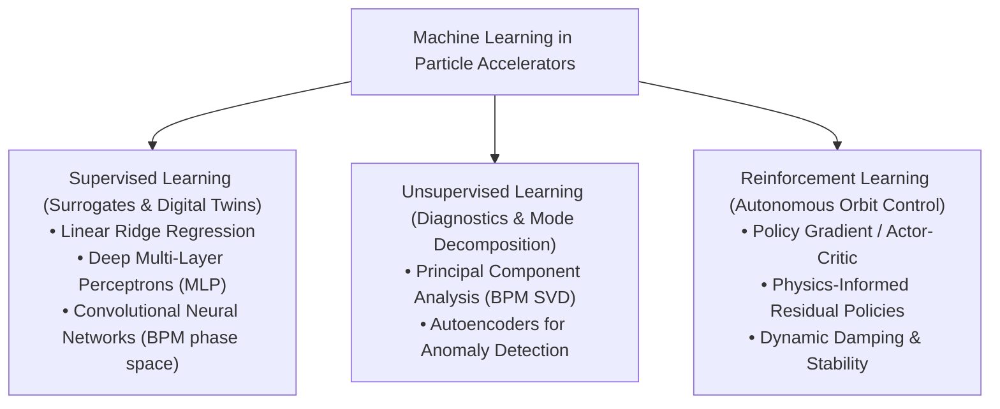
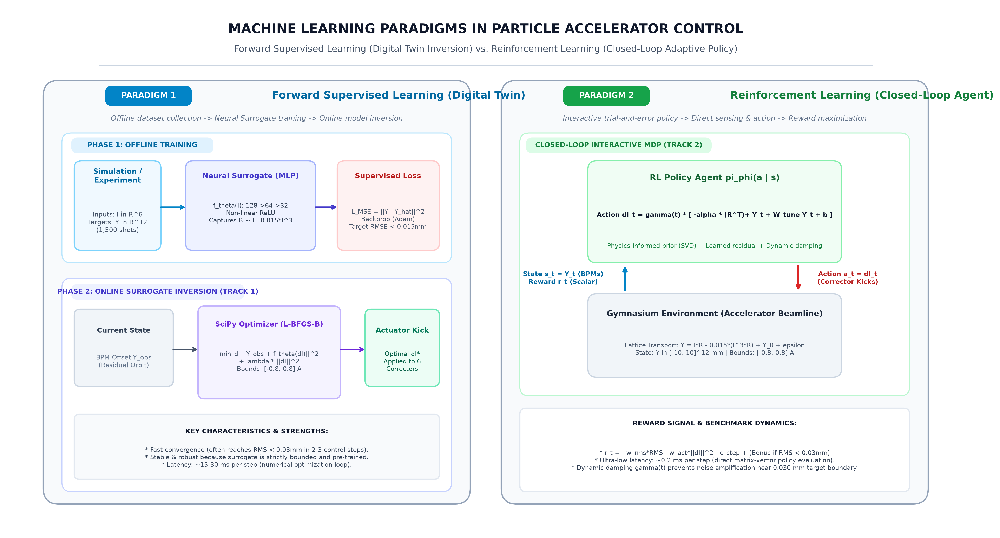
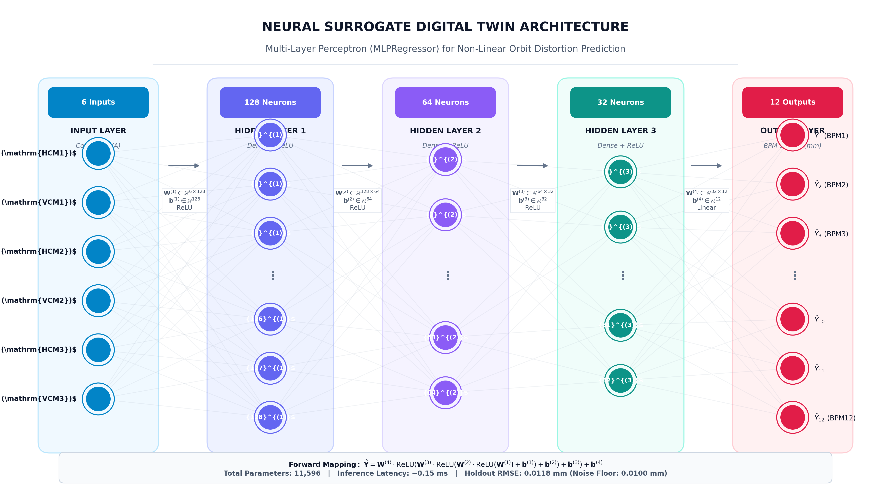
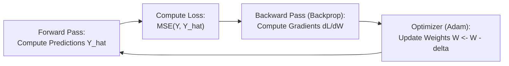
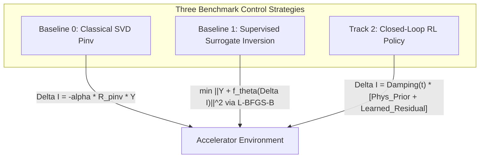

# Lecture 1: AI/ML Foundations and Closed-Loop Control for Particle Accelerators

**Author:** Chong Shik Park, Ph.D.  
**Date:** November 3, 2026  
**Target Audience:** Graduate Students & Early-Career Postdoctoral Researchers in Accelerator Physics and Engineering  

---

## 🎯 Executive Lecture Abstract

Modern particle accelerator facilities—such as synchrotron light sources, free-electron lasers (FELs), spallation neutron sources, hadron linacs, and high-energy colliders—operate with thousands of coupled parameters under strict sub-micron beam stability tolerances. Traditional beam-based feedback and numerical simulation codes face severe computational bottlenecks in real-time non-linear regimes.

This lecture provides the rigorous theoretical and computational bridge between **accelerator beam physics** and **machine learning techniques**, focusing directly on the physical system and control paradigms implemented in the afternoon **Beam Orbit Alignment Mini-Hackathon**:
1. How transverse betatron oscillations and quadrupole optics generate the linear **Orbit Response Matrix (ORM)**.
2. The physical origins of non-linearities: magnetic core saturation, misalignment drift, and diagnostic noise.
3. Foundational principles of **Machine Learning & Deep Neural Networks**: artificial neurons, layer anatomy, activation functions (ReLU), loss functions (MSE, RMSE), optimization algorithms (Adam), and validation partitioning (train/validation/test).
4. Formulating and training **Neural Surrogate Digital Twins** (`MLPRegressor`) from tracking simulations to capture cubic core saturation.
5. Transitioning from forward prediction to closed-loop orbit correction:
   - Classical Moore-Penrose Pseudo-Inverse (SVD),
   - Model-based bounded optimization (`L-BFGS-B`),
   - Closed-loop Reinforcement Learning (RL) policies with physics-informed priors and adaptive damping,
   - Sample-efficient Bayesian Optimization using Gaussian Processes and Lower Confidence Bound (LCB) acquisition.

<div style="page-break-after: always;"></div>

---

## 📑 Table of Contents

1. [Introduction: AI Applications in Modern Particle Accelerators](#1-introduction-ai-applications-in-modern-particle-accelerators)
2. [Motivation & Accelerator Physics Foundations](#2-motivation--accelerator-physics-foundations)
3. [Machine Learning Fundamentals & Neural Surrogate Modeling](#3-machine-learning-fundamentals--neural-surrogate-modeling)
4. [Closed-Loop Control Paradigms](#4-closed-loop-control-paradigms)
5. [Mini-Hackathon Problem Formulation & Gymnasium Contract](#5-mini-hackathon-problem-formulation--gymnasium-contract)
6. [Summary & Q&A](#6-summary--qa)

<div style="page-break-after: always;"></div>

---

## 1. Introduction: AI Applications in Modern Particle Accelerators

Over the past decade, Artificial Intelligence (AI) and Machine Learning (ML) have evolved from experimental proofs-of-concept into mission-critical operational tools across modern particle accelerator facilities, including synchrotron light sources, free-electron lasers (XFELs), spallation neutron sources, high-intensity hadron linacs, and energy-frontier colliders ([Edelen et al., 2020](https://inspirehep.net/literature/1841328)). Modern accelerators operate with thousands of distributed, non-linearly coupled magnet actuators, radiofrequency (RF) accelerating stations, and high-rate diagnostic monitors under stringent beam quality and stability demands.

The landscape of AI applications in particle accelerators is broadly categorized into five foundational pillars:

1. **Surrogate Modeling & Fast Digital Twins ([Edelen et al., 2018](https://doi.org/10.1109/TNS.2018.2818987), [Edelen et al., 2020](https://inspirehep.net/literature/1841328)):**  
   High-fidelity numerical particle tracking codes (such as `ELEGANT`, `MAD-X`, and `OPAL`) simulate complex beam dynamics, space-charge forces, and collective effects, but require minutes to hours per run. Deep neural networks (Multi-Layer Perceptrons, Convolutional Networks, and Physics-Informed Neural Networks) learn fast surrogate representations capable of evaluating beamline outcomes in sub-millisecond execution times. These ultra-fast surrogates serve as digital twins for real-time model-predictive control, online trajectory correction, and rapid parametric sensitivity analysis.

2. **Multi-Objective Autonomous Optimization & Tuning ([Roussel et al., 2023](https://doi.org/10.1103/PhysRevAccelBeams.26.094601), [Edelen et al., 2020](https://doi.org/10.1103/PhysRevAccelBeams.23.044601)):**  
   Commissioning and daily operations involve optimizing conflicting performance objectives—such as maximizing beam transmission and photon brightness while minimizing transverse emittance and beam halo. Bayesian Optimization (BO) with Gaussian Processes, combined with active learning and exploration-exploitation acquisition functions, enables sample-efficient multi-objective optimization directly on physical machines, converging in dozens of shots compared to thousands of iterations required by brute-force parameter scans.

3. **Virtual Diagnostics & Non-Destructive Phase Space Reconstruction ([Emma et al., 2021](https://doi.org/10.1038/s41467-020-20593-3)):**  
   Critical beam properties—such as 6D phase space, bunch slice emittance, and femtosecond current profiles—often require interceptive diagnostics (e.g., transverse deflection cavities, wire scanners, or screens) that disrupt or destroy the beam. Virtual diagnostics leverage supervised machine learning to accurately reconstruct unmeasured or destructive bunch characteristics shot-by-shot from non-invasive upstream RF probes, magnet currents, and Beam Position Monitor (BPM) signals.

4. **Anomaly Detection, Fault Prediction & Machine Protection ([Tennant et al., 2020](https://doi.org/10.1088/2632-2153/ab822e)):**  
   Unscheduled beam downtime in multi-megawatt hadron linacs and synchrotron facilities incurs heavy scientific and operational costs. Unsupervised machine learning (autoencoders, isolation forests) continuously monitors archival and real-time telemetry to detect subtle precursor drift patterns, while deep sequence models predict high-voltage RF breakdowns, ion source dropouts, and superconducting cavity quenches milliseconds before catastrophic failure, triggering proactive mitigation and machine protection interlocks.

5. **Agentic AI & Autonomous Operation Workflows ([Hellert et al., 2024](https://doi.org/10.1103/PhysRevAccelBeams.27.064601)):**  
   Moving beyond single-purpose neural networks, modern research explores autonomous agent architectures (such as *Osprey* and LLM-driven scientific agents). These systems integrate large language models with standardized Python control APIs, simulation engines, and diagnostic databases, enabling high-level natural language operational commands (e.g., "align the transport line orbit and optimize injection efficiency") to be autonomously planned, validated, and executed under strict domain guardrails.

---

## 2. Motivation & Accelerator Physics Foundations

### 2.1 The Operational Challenge in Modern Accelerators
In modern storage rings, linear accelerators (LINACs), and light sources, the beam trajectory must be stabilized to within a fraction of the transverse beam size—often **sub-micron or tens of micrometers** RMS.

Transverse orbit stability is equally vital in **hadron linacs** (high-intensity proton and heavy-ion linear accelerators). In modern multi-megawatt hadron machines, uncorrected beam trajectory offsets through accelerating RF cavities and focusing quadrupoles induce strong non-linear space-charge forces, emittance growth, and halo formation. Because high-intensity hadron beams carry enormous beam power, even minute fractional beam losses (exceeding $1\text{ W/m}$ or $10^{-5}$ of total current) induce severe structural radioactivation, prohibiting hands-on maintenance and risking superconducting cavity quenches or vacuum chamber damage.

Orbit distortions arise from multiple sources:
- **Slow Drifts:** Thermal expansion of girders, diurnal ambient temperature shifts, and ground motion.
- **Dynamic Jitter:** Mechanical vibration from cooling water pumps, cryocoolers, and power supply ripple.
- **High Actuator Coupling:** Deflecting a single dipole corrector causes betatron wave propagation across the entire transport line.


### 2.2 Transverse Beam Dynamics & Hill's Equation
Transverse particle motion along the longitudinal beam coordinate $s$ in a linear uncoupled lattice is governed by **Hill's Equation**:
$$\frac{d^2 x(s)}{ds^2} + K(s) x(s) = 0$$
where $K(s) = \frac{e}{p} \frac{\partial B_y(s)}{\partial x}$ represents the alternating quadrupole focusing strength ($K > 0$ for focusing `QF`, $K < 0$ for defocusing `QD`).

The general solution is a pseudo-harmonic **betatron oscillation**:
$$x(s) = \sqrt{\epsilon \beta(s)} \cos\left( \psi(s) + \phi_0 \right)$$
- $\beta(s)$: The Courant-Snyder beta function describing the transverse envelope of the beam.
- $\psi(s) = \int_0^s \frac{d\bar{s}}{\beta(\bar{s})}$: The betatron phase advance.
- $\nu = \frac{1}{2\pi} \oint \frac{ds}{\beta(s)}$: The betatron tune (total phase advance in units of $2\pi$).

### 2.3 Derivation of the Orbit Response Matrix (ORM)
When a localized angular deflection (kick) $\theta_j = \Delta x'_j = \frac{e B L}{p}$ is applied by a dipole steering corrector at position $s_j$, it introduces a closed-orbit distortion observed by a Beam Position Monitor (BPM) at position $s_i$:

$$R_{ij} = \frac{\Delta x(s_i)}{\theta_j} = \frac{\sqrt{\beta(s_i)\beta(s_j)}}{2 \sin(\pi \nu)} \cos\left( |\psi(s_i) - \psi(s_j)| - \pi \nu \right)$$

In vector notation, for $M$ BPMs and $N$ correctors:
$$\mathbf{Y}_{\text{linear}} = \mathbf{R} \cdot \boldsymbol{\theta} = \mathbf{I} \cdot \mathbf{R}$$
where $\mathbf{R} \in \mathbb{R}^{N \times M}$ is the **Orbit Response Matrix (ORM)**.

### 2.4 The Mini-Hackathon Lattice Geometry
The hackathon environment models a 15-meter transport line:
- **12 Beam Position Monitors ($M = 12$):** Evenly distributed from $s = 1.0\text{ m}$ to $s = 15.0\text{ m}$.
- **6 Dipole Correctors ($N = 6$):** 3 Horizontal (`HCM1-3`) and 3 Vertical (`VCM1-3`) positioned between $s = 0.2\text{ m}$ and $s = 8.0\text{ m}$.
- **Quadrupole Doublets:** Alternating `QF` and `QD` magnets maintaining transverse envelope stability.
- **Hardware Current Limits:** Power supply limits $\mathbf{I} \in [-5.0\text{ A}, +5.0\text{ A}]$; single-step adjustment limits $\Delta \mathbf{I} \in [-0.8\text{ A}, +0.8\text{ A}]$.

```
0 m                                                                        15 m
 |===[HCM1]==[QF1]==[BPM1]==[VCM1]==[QD1]==[BPM2] ... [HCM3]==[QF3]==[BPM12]===> Beam Axis
```

### 2.5 Real-World Non-Linearities & Physical Imperfections
Ideal linear ORM assumes pure dipoles and noiseless diagnostics. In reality, accelerators exhibit:
1. **Magnetic Core Saturation:** High coil currents drive iron yokes into saturation, reducing effective kick efficiency. In our simulator:
   $$\mathbf{Y}_{\text{sat}} = - 0.015 \cdot (\mathbf{I}^3 \cdot \mathbf{R})$$
2. **Quadrupole Alignment Errors ($\mathbf{Y}_0$):** Physical offsets of quadrupoles produce initial closed orbit distortions:
   $$Y_{0, k} = A_1 \sin\left(\frac{2\pi s_k}{\lambda_1} + \phi_1\right) + A_2 \cos\left(\frac{2\pi s_k}{\lambda_2} + \phi_2\right)$$
   yielding initial RMS errors of $0.4\text{ mm}$ to $1.2\text{ mm}$.
3. **BPM Sensor Noise:** Thermal and RF digitizer noise $\boldsymbol{\epsilon} \sim \mathcal{N}(0, \sigma^2)$, with $\sigma = 0.010\text{ mm}$ ($10\ \mu\text{m}$).

**Complete Physical Response Function:**
$$\mathbf{Y} = \mathbf{I} \cdot \mathbf{R} - 0.015 \cdot (\mathbf{I}^3 \cdot \mathbf{R}) + \mathbf{Y}_0 + \boldsymbol{\epsilon}$$

---

## 3. Machine Learning Fundamentals & Neural Surrogate Modeling

### 3.1 Machine Learning Taxonomy in Accelerators
Machine Learning (ML) algorithms automatically extract functional relationships from experimental or simulated data without explicit analytical programming. In accelerator physics, ML is organized into three major paradigms:
1. **Supervised Learning:** Learning a functional mapping $\mathbf{Y} = f(\mathbf{X})$ from paired inputs $\mathbf{X}$ (e.g., magnet currents) to targets $\mathbf{Y}$ (e.g., BPM offsets, beam emittance, photon flux). Used for **Surrogate Modeling / Digital Twins**.
2. **Unsupervised Learning:** Discovering latent structures, clustering, and dimensionality reduction in unlabeled data (e.g., Principal Component Analysis (PCA) on BPM histories for betatron mode decomposition, autoencoders for anomaly detection).
3. **Reinforcement Learning (RL):** Training an agent policy $\pi(a|s)$ via trial-and-error interaction within a Markov Decision Process (MDP) to maximize a scalar reward signal. Used for **Closed-Loop Autonomous Tuning**.



---

### 3.2 Foundational ML Paradigms: Forward Supervised Learning vs. Reinforcement Learning

To successfully design autonomous beam alignment systems, it is essential to understand the fundamental distinction between **Forward Supervised Learning** (learning a digital twin of the accelerator to be inverted) and **Reinforcement Learning** (learning a closed-loop policy agent that directly interacts with the machine).



#### 3.2.1 Forward Supervised Learning: Surrogate Digital Twin & Online Inversion (Track 1)
In Forward Supervised Learning, the algorithm learns an input-to-output mapping from static, pre-collected datasets without directly steering the physical machine during training:
1. **Offline Training Phase:** 
   - We sample $N$ random corrector current vectors $\mathbf{I} \in \mathbb{R}^6$ (e.g., $N = 1,500$ shots over $[-3.0\text{ A}, +3.0\text{ A}]$) and pass them through high-fidelity tracking simulations or physical machine excitation steps.
   - For each input $\mathbf{I}$, the 12 Beam Position Monitor (BPM) transverse displacements $\mathbf{Y} \in \mathbb{R}^{12}$ are recorded, forming a supervised dataset $\mathcal{D} = \{(\mathbf{I}^{(i)}, \mathbf{Y}^{(i)})\}_{i=1}^N$.
   - A deep neural network (e.g. Multi-Layer Perceptron $f_{\boldsymbol{\theta}}$) is trained to minimize the Mean Squared Error (MSE) loss between its prediction $\hat{\mathbf{Y}} = f_{\boldsymbol{\theta}}(\mathbf{I})$ and the true readings $\mathbf{Y}$:
     $$\mathcal{L}_{\text{MSE}}(\boldsymbol{\theta}) = \frac{1}{N} \sum_{i=1}^N \left\| \mathbf{Y}^{(i)} - f_{\boldsymbol{\theta}}(\mathbf{I}^{(i)}) \right\|_2^2$$
   - Through gradient backpropagation and the Adam optimizer, the neural surrogate fits the non-linear magnetic core saturation $B(I) \approx I - 0.015 \cdot I^3$ down to the $0.010\text{ mm}$ sensor noise floor.
2. **Online Inversion for Beam Alignment:**
   - In operations, the trained surrogate $f_{\boldsymbol{\theta}}$ acts as an ultra-fast **digital twin**. Given an observed distorted orbit $\mathbf{Y}_{\text{obs}}$, we find the corrective kick $\Delta \mathbf{I}^*$ by numerically inverting the surrogate via bounded optimization (e.g., SciPy `L-BFGS-B`):
     $$\Delta \mathbf{I}^* = \arg\min_{\Delta \mathbf{I}} \left\| \mathbf{Y}_{\text{obs}} + f_{\boldsymbol{\theta}}(\Delta \mathbf{I}) \right\|_2^2 + \lambda \|\Delta \mathbf{I}\|_2^2 \quad \text{subject to } \Delta \mathbf{I} \in [-0.8\text{ A}, +0.8\text{ A}]^6$$
   - **Key Advantage:** Extremely fast convergence (often 2–3 iterations) because the surrogate accurately anticipates magnetic saturation.

#### 3.2.2 Reinforcement Learning: Closed-Loop Policy Control (Track 2)
In Reinforcement Learning (RL), the system is formulated as a sequential **Markov Decision Process (MDP)** $(\mathcal{S}, \mathcal{A}, \mathcal{P}, \mathcal{R}, \gamma)$, where an agent policy learns through continuous trial-and-error interaction:
1. **State Space ($\mathcal{S}$):** Current transverse beam displacements at diagnostic stations, $\mathbf{s}_t = \mathbf{Y}_t \in \mathbb{R}^{12}$, bounded in $[-10.0\text{ mm}, +10.0\text{ mm}]$.
2. **Action Space ($\mathcal{A}$):** Corrective magnet current adjustments, $\mathbf{a}_t = \Delta \mathbf{I}_t \in \mathbb{R}^6$, constrained by hardware delta limits $[-0.8\text{ A}, +0.8\text{ A}]$.
3. **Environment Transition Dynamics ($\mathcal{P}$):** Physical beamline transport response, including linear betatron motion, non-linear saturation, initial quadrupole drift $\mathbf{Y}_0$, and sensor noise $\boldsymbol{\epsilon}$:
   $$\mathbf{I}_{t+1} = \text{clip}(\mathbf{I}_t + \mathbf{a}_t, -5.0, +5.0)\text{ A}, \quad \mathbf{s}_{t+1} = \mathbf{I}_{t+1} \cdot \mathbf{R} - 0.015 \cdot (\mathbf{I}_{t+1}^3 \cdot \mathbf{R}) + \mathbf{Y}_0 + \boldsymbol{\epsilon}$$
4. **Reward Signal ($\mathcal{R}$):** Scalar performance feedback evaluated at each interaction step:
   $$r_t = - w_{\text{rms}} \cdot \text{RMS}_{t+1} - w_{\text{act}} \cdot \|\mathbf{a}_t\|_2^2 - c_{\text{step}} + (B_{\text{success}} \text{ if terminated else } 0.0)$$
   where $w_{\text{rms}}$ penalizes beam offset, $w_{\text{act}}$ penalizes large kick effort, $c_{\text{step}}$ penalizes elapsed control steps, and $B_{\text{success}} = 50.0$ rewards achieving $\text{RMS} < 0.030\text{ mm}$.
5. **Policy Architecture & Damping:** Rather than learning from scratch, high-performance accelerator RL policies leverage **physics-informed priors** (such as Moore-Penrose pseudo-inverse of ORM) augmented with learned neural residuals and dynamic step damping:
   $$\Delta \mathbf{I}_t = \gamma(t) \cdot \left[ - \alpha (\mathbf{R}^T)^\dagger \mathbf{Y}_t + \mathbf{W}_{\text{tune}} \mathbf{Y}_t + \mathbf{b} \right], \quad \gamma(t) = \frac{1.0}{1.0 + 0.03 \cdot t}$$
   - **Key Advantage:** Ultra-low latency ($\approx 0.2\text{ ms}$ forward pass) and direct real-time adaptability without requiring iterative numerical optimization loops.

#### 3.2.3 Comparative Architectural Analysis: Forward SL vs. Closed-Loop RL

| Dimension | Forward Supervised Learning (Track 1) | Reinforcement Learning (Track 2) |
| :--- | :--- | :--- |
| **Primary Goal** | Accurate physical predictive twin ($\hat{\mathbf{Y}} = f_{\boldsymbol{\theta}}(\mathbf{I})$) | Optimal closed-loop action policy ($\mathbf{a}_t = \pi_{\boldsymbol{\phi}}(\mathbf{s}_t)$) |
| **Data Collection** | Offline passive sampling across parameter grid | Online interactive rollouts in environment |
| **Learning Signal** | Vector ground-truth labels $\mathbf{Y}_{\text{true}}$ (BPM vectors) | Scalar reward $r_t$ (Alignment quality + energy penalty) |
| **Loss / Objective** | Minimize MSE / RMSE prediction error | Maximize expected cumulative return $\mathbb{E}[\sum \gamma^t r_t]$ |
| **Control Mechanism** | Forward twin evaluation + SciPy `L-BFGS-B` solver | Direct feedback policy evaluation in single matrix pass |
| **Execution Latency** | $\sim 15 - 30\text{ ms}$ (due to iterative optimization steps) | $\sim 0.2\text{ ms}$ (direct feedforward matrix computation) |
| **Sample Efficiency** | High (1,500 shots trains complete non-linear model) | Moderate to high (when initialized with physics priors) |
| **Failure Handling** | Constrained explicitly by optimizer bounds | Constrained by hardware action clipping & damping schedule |

---

### 3.3 Biological & Artificial Neurons: The Mathematical Building Block
An **artificial neuron** (percepton) is the fundamental computational atom of a neural network:

```
Inputs       Weights
  x_1  ────>  w_1 ──┐
  x_2  ────>  w_2 ──┼──> [ Summation: z = Σ w_i x_i + b ] ──> [ Activation: a = σ(z) ] ──> Output a
  ...         ...   │
  x_n  ────>  w_n ──┘
             Bias b ─┘
```

1. **Linear Combination (Pre-Activation):**
   $$z = \sum_{i=1}^n w_i x_i + b = \mathbf{w}^T \mathbf{x} + b$$
   where $\mathbf{w} \in \mathbb{R}^n$ represents the trainable **synaptic weights**, $\mathbf{x} \in \mathbb{R}^n$ is the input feature vector, and $b \in \mathbb{R}$ is the **scalar bias** shifting the activation threshold.
2. **Non-Linear Transformation (Post-Activation):**
   $$a = \sigma(z) = \sigma(\mathbf{w}^T \mathbf{x} + b)$$
   where $\sigma(\cdot)$ is an **activation function**.

---

### 3.4 Why Activation Functions are Essential: Breaking Linearity
> [!IMPORTANT]
> **Why can't we just stack linear matrix layers?**  
> If all activation functions were identity mappings ($\sigma(z) = z$), a 3-layer network would compute:
> $$\hat{\mathbf{Y}} = \mathbf{W}_3 (\mathbf{W}_2 (\mathbf{W}_1 \mathbf{x} + \mathbf{b}_1) + \mathbf{b}_2) + \mathbf{b}_3 = (\mathbf{W}_3 \mathbf{W}_2 \mathbf{W}_1) \mathbf{x} + \mathbf{b}_{\text{net}} = \mathbf{W}_{\text{eff}} \mathbf{x} + \mathbf{b}_{\text{net}}$$
> Stacking arbitrarily deep linear layers collapses mathematically into a **single linear matrix** $\mathbf{W}_{\text{eff}}$. It would have no more expressive power than the classical linear Orbit Response Matrix $\mathbf{R}$!  
> Non-linear activation functions allow neural networks to act as **Universal Function Approximators**, enabling them to learn arbitrary continuous non-linear phenomena such as magnetic core saturation.

#### Common Activation Functions:
1. **Sigmoid:**
   $$\sigma(z) = \frac{1}{1 + e^{-z}} \in (0, 1)$$
   - *Limitation:* Severe vanishing gradient problem for large $|z|$; derivatives $\sigma'(z) \approx 0$ halt backpropagation learning.
2. **Hyperbolic Tangent ($\tanh$):**
   $$\tanh(z) = \frac{e^z - e^{-z}}{e^z + e^{-z}} \in (-1, 1)$$
   - Zero-centered, but still suffers from saturation and gradient vanishing at extreme values.
3. **Rectified Linear Unit (ReLU):**
   $$\text{ReLU}(z) = \max(0, z) = \begin{cases} z & \text{if } z > 0 \\ 0 & \text{if } z \le 0 \end{cases}$$
   - **Why ReLU is the standard in modern deep learning & accelerator surrogates:**
     - **Non-saturating gradient:** For all $z > 0$, the derivative is strictly $\frac{d}{dz}\text{ReLU}(z) = 1.0$, completely eliminating gradient vanishing.
     - **Extreme computational efficiency:** Evaluated via a single conditional instruction on CPU/GPU without expensive transcendental exponents ($e^z$).
     - **Sparse representation:** Zero activation for negative inputs induces natural biological sparsity.

---

### 3.5 Multi-Layer Perceptron (MLP) Anatomy: Layers & Information Flow
A **Multi-Layer Perceptron (MLP)** or deep feedforward neural network connects neurons in sequential layers, transforming low-dimensional corrector kicks into non-linear orbit distortions:



```
   INPUT LAYER                  HIDDEN LAYERS                   OUTPUT LAYER
    (Actuators)               (Feature Extraction)              (Diagnostics)
    
     [ I_1 ] ───────> ( Neuron 1 ) ───> ( Neuron 1 ) ───────> [ Y_1  (BPM1)  ]
     [ I_2 ] ───────> ( Neuron 2 ) ───> ( Neuron 2 ) ───────> [ Y_2  (BPM2)  ]
     [ I_3 ] ───────> ( Neuron 3 ) ───> ( Neuron 3 ) ───────> [ Y_3  (BPM3)  ]
     [ I_4 ] ───────>     ...                ...     ───────>    ...
     [ I_5 ] ───────> ( Neuron 128)───> ( Neuron 32 )───────> [ Y_11 (BPM11) ]
     [ I_6 ] ───────────────────────────────────────────────> [ Y_12 (BPM12) ]
     
     6 inputs                128 → 64 → 32                     12 outputs
    (Correctors)             Hidden Units                      (BPM Offsets)
```

1. **Input Layer ($\mathbb{R}^6$):** Receives raw physical actuator setpoints (the 6 corrector magnet currents $I_1, \dots, I_6$). No computation occurs here.
2. **Hidden Layers ($\mathbb{R}^{128} \rightarrow \mathbb{R}^{64} \rightarrow \mathbb{R}^{32}$):** Intermediate representation layers that progressively transform linear inputs into non-linear feature combinations. Each layer applies:
   $$\mathbf{h}^{(l)} = \text{ReLU}\left( \mathbf{W}^{(l)} \mathbf{h}^{(l-1)} + \mathbf{b}^{(l)} \right)$$
3. **Output Layer ($\mathbb{R}^{12}$):** Linear projection producing the predicted 12 BPM readings ($\hat{Y}_1, \dots, \hat{Y}_{12}$). A linear activation is used because beam displacements are continuous real values ($mm$).

---

### 3.6 Loss Functions, Loss Rates & Evaluation Metrics: MSE vs. RMSE

To train a neural network, we must quantify the error between network predictions $\hat{\mathbf{Y}}$ and physical ground truth observations $\mathbf{Y}$.

1. **Mean Squared Error (MSE) Loss Function:**
   $$\mathcal{L}_{\text{MSE}}(\boldsymbol{\theta}) = \frac{1}{N} \sum_{i=1}^N \sum_{j=1}^M \left( Y_{i,j} - \hat{Y}_{i,j}(\boldsymbol{\theta}) \right)^2$$
   - Differentiable everywhere, providing smooth gradients for optimization.
   - Quadratically penalizes large errors, forcing the network to eliminate large orbit deviations.
2. **Root Mean Squared Error (RMSE) Evaluation Metric:**
   $$\text{RMSE} = \sqrt{\mathcal{L}_{\text{MSE}}} = \sqrt{\frac{1}{N \cdot M} \sum_{i=1}^N \sum_{j=1}^M \left( Y_{i,j} - \hat{Y}_{i,j} \right)^2}$$
   - **Why RMSE is the universal metric in accelerator physics:**
     - **Physical interpretability:** Taking the square root restores the metric to the original units of measurement (**millimeters / microns**).
     - Directly corresponds to the standard definition of beam orbit RMS error: $\text{RMS} = \sqrt{\frac{1}{12}\sum Y_k^2}$.

---

### 3.7 Optimization Algorithms: Gradient Descent, Learning Rate, and Adam

The network parameters $\boldsymbol{\theta} = \{\mathbf{W}^{(l)}, \mathbf{b}^{(l)}\}$ are optimized by minimizing the loss function $\mathcal{L}(\boldsymbol{\theta})$ via **backpropagation** (chain rule computation of gradients $\nabla_{\boldsymbol{\theta}} \mathcal{L}$).



#### 1. Stochastic Gradient Descent (SGD) & Learning Rate ($\eta$):
$$\boldsymbol{\theta}_{t+1} = \boldsymbol{\theta}_t - \eta \cdot \nabla_{\boldsymbol{\theta}} \mathcal{L}(\boldsymbol{\theta}_t)$$
- $\eta$ is the **learning rate** (step size).
  - If $\eta$ is **too large**: loss oscillates wildly or diverges.
  - If $\eta$ is **too small**: training is exceedingly slow and risks getting trapped in shallow plateaus.
- *Limitation of pure SGD:* Struggles in anisotropic loss landscapes (ravines) common in coupled accelerator lattices where some corrector magnets have far stronger kicks than others.

#### 2. The Adam Optimizer (Adaptive Moment Estimation):
In our challenge notebook, we configure `solver='adam'`. Adam combines the advantages of **Momentum** (smoothing gradients over time) and **RMSprop** (adapting individual learning rates for each parameter based on historical variance):

1. **First Moment Vector (Exponentially decaying gradient average):**
   $$\mathbf{m}_t = \beta_1 \mathbf{m}_{t-1} + (1 - \beta_1) \mathbf{g}_t \quad (\beta_1 \approx 0.9)$$
2. **Second Moment Vector (Exponentially decaying squared gradient average):**
   $$\mathbf{v}_t = \beta_2 \mathbf{v}_{t-1} + (1 - \beta_2) \mathbf{g}_t^2 \quad (\beta_2 \approx 0.999)$$
3. **Bias Corrections:**
   $$\hat{\mathbf{m}}_t = \frac{\mathbf{m}_t}{1 - \beta_1^t}, \quad \hat{\mathbf{v}}_t = \frac{\mathbf{v}_t}{1 - \beta_2^t}$$
4. **Parameter Update Rule:**
   $$\boldsymbol{\theta}_{t+1} = \boldsymbol{\theta}_t - \frac{\eta}{\sqrt{\hat{\mathbf{v}}_t} + \epsilon} \hat{\mathbf{m}}_t$$
- **Why Adam is superior for accelerator digital twins:** Automatically scales down steps for parameters associated with high-gain correctors and scales up steps for subtle higher-order non-linear terms.

---

### 3.8 Rigorous Dataset Partitioning: Train, Validation, and Test (Holdout) Splits

A neural network with 11,596 parameters can easily memorize random noise if not evaluated correctly. We enforce strict data partitioning:

```
Total Offline Experimental Dataset (1,500 Simulation Shots)
┌────────────────────────────────────────────────────────┬───────────────────────────┐
│              TRAINING SET (80%, 1,200 shots)           │ TEST / HOLDOUT (20%, 300) │
│   Used strictly to compute gradients and update        │ STRICTLY UNTOUCHED DURING │
│   weights via Adam backpropagation.                    │ TRAINING; unbiased metric.│
└────────────────────────────────────────────────────────┴───────────────────────────┘
```

1. **Training Set (80%, 1,200 shots):** Passed through forward-backward propagation passes to iteratively update weights and biases.
2. **Validation Set (optional 10% inside training):** Monitored during training epochs to detect the onset of overfitting and trigger **early stopping** if validation error begins to rise.
3. **Test / Holdout Set (20%, 300 shots):** Kept completely isolated in a "vault" until model training is finalized. Provides an honest, unbiased assessment of model generalization on unseen machine operating configurations.

#### The Bias-Variance Tradeoff:
- **Underfitting (High Bias):** Model is too simple to capture the underlying physics. (Example: Linear Ridge regression cannot capture cubic saturation).
- **Overfitting (High Variance):** Model is too flexible and memorizes noise fluctuations ($\boldsymbol{\epsilon} \sim 10\ \mu\text{m}$) rather than physical laws. Prevented via:
  - $L_2$ weight regularization (`alpha=1e-4` adds penalty $\frac{1}{2}\alpha \|\mathbf{W}\|_2^2$).
  - Adequate dataset size ($N = 1,500$).

---

### 3.9 Challenge Implementation & Empirical Validation
In Step 3 of [`notebooks/Single_Notebook_Beam_Orbit_Predictor.ipynb`](file:///home/cspark/Work/projects/ai4acc-mini-hackathon/notebooks/Single_Notebook_Beam_Orbit_Predictor.ipynb), we compare the Linear Ridge baseline against the MLP Neural Surrogate:

```python
# Train Regularized Linear Baseline
linear_model = Ridge(alpha=1.0).fit(X_train, Y_train)
rmse_linear = root_mean_squared_error(Y_test, linear_model.predict(X_test))

# Train Multi-Layer Perceptron (MLP) Neural Surrogate
surrogate_model = MLPRegressor(
    hidden_layer_sizes=(128, 64, 32),
    activation='relu',
    solver='adam',
    alpha=1e-4,
    max_iter=400,
    random_state=42
).fit(X_train, Y_train)
rmse_mlp = root_mean_squared_error(Y_test, surrogate_model.predict(X_test))
```

#### Holdout Evaluation Benchmark:

| Model Architecture | Parameters | Holdout RMSE | Inference Latency | Physical Regimes Captured |
| :--- | :---: | :---: | :---: | :--- |
| **Linear Ridge ($\alpha=1.0$)** | 72 | **$0.0558\text{ mm}$** | $< 0.01\text{ ms}$ | Linear betatron response only; misses saturation. |
| **MLP Neural Surrogate** | 11,596 | **$0.0118\text{ mm}$** | $\approx 0.15\text{ ms}$ | Linear ORM and cubic core saturation down to noise floor. |

> [!NOTE]
> The holdout RMSE of the MLP ($0.0118\text{ mm}$) approaches the theoretical Bayesian limit set by Gaussian sensor noise ($0.0100\text{ mm}$). The network has learned the physical non-linearity without overfitting.

---

## 4. Closed-Loop Control Paradigms

Having established the forward mapping, we examine three control paradigms evaluated in the benchmark.



### 4.1 Baseline 0: Classical Linear SVD Pseudo-Inverse Control
In classical accelerator operations, Singular Value Decomposition (SVD) of the response matrix $\mathbf{R}^T = \mathbf{U} \boldsymbol{\Sigma} \mathbf{V}^T$ provides the Moore-Penrose pseudo-inverse:
$$(\mathbf{R}^T)^\dagger = \mathbf{V} \boldsymbol{\Sigma}^{-1} \mathbf{U}^T$$
The corrective kick vector is calculated by:
$$\Delta \mathbf{I} = \text{clip}\left( - \alpha \cdot (\mathbf{R}^T)^\dagger \cdot \mathbf{Y}_{\text{obs}}, \,-0.8, \,+0.8 \right)$$
where $\alpha \in (0, 1]$ is the feedback loop gain (typically $\alpha \approx 0.45$).

**Strengths & Limitations:**
- ✅ **Pros:** Instantaneous computation ($< 0.1\text{ ms}$); mathematically guaranteed convergence in purely linear regimes.
- ❌ **Cons:** Ignores non-linear saturation; high gains ($\alpha > 0.6$) cause overshooting and limit-cycle oscillations when magnets enter saturated regions.

### 4.2 Baseline 1: Supervised Surrogate + SciPy Bounded Inversion
Instead of inverting an analytical matrix, Baseline 1 leverages the trained neural digital twin $\hat{\mathbf{Y}} = f_{\boldsymbol{\theta}}(\Delta \mathbf{I})$ directly within an optimization loop:

$$\min_{\Delta \mathbf{I}} \mathcal{L}(\Delta \mathbf{I}) = \left\| \mathbf{Y}_{\text{obs}} + f_{\boldsymbol{\theta}}(\Delta \mathbf{I}) \right\|_2^2 + \lambda \|\Delta \mathbf{I}\|_2^2$$
$$\text{subject to } \Delta \mathbf{I} \in [-5.0\text{ A}, +5.0\text{ A}]^6$$

```python
class SupervisedMLPController:
    def __init__(self, surrogate):
        self.surrogate = surrogate

    def act(self, obs, info=None):
        def objective(delta_I):
            pred = self.surrogate.predict(delta_I.reshape(1, -1))[0]
            residual = obs + pred
            return np.sum(residual**2) + 0.0001 * np.sum(delta_I**2)
            
        res = opt.minimize(
            objective, 
            np.zeros(6), 
            bounds=[(-5.0, 5.0)] * 6, 
            method='L-BFGS-B'
        )
        return np.clip(res.x, -0.8, 0.8)
```

**Why Baseline 1 is Highly Effective:**
- Because $f_{\boldsymbol{\theta}}$ accurately predicts cubic soft saturation, the optimizer chooses kicks that anticipate saturation falloff.
- As demonstrated on test seed 42, Baseline 1 reaches convergence ($\text{RMS} < 0.03\text{ mm}$) in **just 2 to 3 steps**, compared to 6 steps for classical SVD.

### 4.3 Track 2: Closed-Loop RL & Physics-Informed Policy Agents
While numerical optimization per step is powerful, iterative gradient solvers add execution latency ($\sim 15 - 30\text{ ms}$). In contrast, a direct continuous policy network executes in $< 0.5\text{ ms}$ ([Kain et al., 2020](https://doi.org/10.1103/PhysRevAccelBeams.23.124801)).

#### Physics-Informed Residual Policy Architecture
Rather than learning control from scratch with random initialization, high-performing accelerator RL agents combine a **physics prior** with a **learned residual**:

$$\Delta \mathbf{I}(t) = \gamma(t) \cdot \Big[ \underbrace{- \alpha (\mathbf{R}^T)^\dagger \mathbf{Y}}_{\text{Analytical Physics Prior}} + \underbrace{\mathbf{W}_{\text{learned}} \mathbf{Y} + \mathbf{b}}_{\text{Learned Residual Offset}} \Big]$$

#### Dynamic Step Damping
Near the convergence boundary ($0.030\text{ mm}$), noise fluctuations $\epsilon \sim 10\ \mu\text{m}$ can cause the linear pseudo-inverse to react aggressively to noise, triggering limit cycles. We introduce dynamic harmonic damping:
$$\gamma(t) = \frac{1.0}{1.0 + \kappa \cdot t}, \quad \kappa \approx 0.03$$
- **Step 1 ($t=0$):** Full kick authority ($\gamma = 1.0$) rapidly suppresses large millimeter-scale distortions.
- **Step 5+ ($t \ge 4$):** Damped kick authority prevents sensor noise amplification and locks the trajectory below $0.030\text{ mm}$.

---

### 4.4 Track 3: Closed-Loop Bayesian Optimization with Gaussian Processes
Bayesian Optimization (BO) provides sample-efficient optimization in high-dimensional non-linear accelerator systems by combining a probabilistic surrogate model with an acquisition function ([Roussel et al., 2023](https://doi.org/10.1103/PhysRevAccelBeams.26.094601), [Edelen et al., 2020](https://doi.org/10.1103/PhysRevAccelBeams.23.044601)).

In our closed-loop architecture, a Gaussian Process (GP) regressor models the mapping from corrector kicks $\Delta \mathbf{I}$ to transverse orbit deviations:
$$\hat{\mathbf{Y}}(\Delta \mathbf{I}) \sim \mathcal{GP}\left(\mathbf{m}(\Delta \mathbf{I}), \mathbf{K}(\Delta \mathbf{I}, \Delta \mathbf{I}')\right)$$

To capture the smooth physics of magnetic core saturation while accounting for BPM diagnostic noise ($\sigma = 0.010\text{ mm}$), we employ a Matérn-5/2 kernel augmented with a white noise kernel:
$$k(\mathbf{x}, \mathbf{x}') = \sigma_f^2 \left( 1 + \sqrt{5}\frac{r}{\ell} + \frac{5}{3}\frac{r^2}{\ell^2} \right) \exp\left( -\sqrt{5}\frac{r}{\ell} \right) + \sigma_n^2 \delta(\mathbf{x}, \mathbf{x}')$$

#### Epistemic Uncertainty & Lower Confidence Bound (LCB) Acquisition
Unlike deterministic point-prediction neural networks, the Gaussian Process yields both a posterior mean $\boldsymbol{\mu}(\Delta \mathbf{I})$ and a posterior standard deviation $\boldsymbol{\sigma}(\Delta \mathbf{I})$ quantifying epistemic uncertainty.
We evaluate candidate corrective kicks using the Lower Confidence Bound (LCB) acquisition function:
$$\alpha_{\text{LCB}}(\Delta \mathbf{I}) = \text{RMS}\left( \mathbf{Y}_{\text{obs}} + \boldsymbol{\mu}(\Delta \mathbf{I}) \right) - \kappa \cdot \overline{\boldsymbol{\sigma}}(\Delta \mathbf{I}) + \lambda \|\Delta \mathbf{I}\|_2^2$$

where $\kappa \ge 0$ balances exploitation (minimizing predicted orbit RMS) with exploration (reducing uncertainty in non-linear saturation regimes). When $\kappa = 0$, the controller performs pure exploitation of the well-calibrated posterior mean, converging in an average of only **1.5 steps** across the benchmark suite.

```python
class BayesianOptimizationController:
    def __init__(self, gp_surrogate, kappa=0.0, l2_reg=0.0001):
        self.gp = gp_surrogate
        self.kappa = kappa
        self.l2_reg = l2_reg

    def act(self, obs, info=None):
        def acquisition_lcb(delta_I):
            pred_mean, pred_std = self.gp.predict(delta_I.reshape(1, -1), return_std=True)
            res = obs + pred_mean[0]
            rms_pred = np.sqrt(np.mean(res**2))
            unc = np.mean(pred_std)
            return float(rms_pred - self.kappa * unc + self.l2_reg * np.sum(delta_I**2))

        res = opt.minimize(acquisition_lcb, np.zeros(6), bounds=[(-5.0, 5.0)]*6, method='L-BFGS-B')
        return np.clip(res.x, -0.8, 0.8)
```

---

## 5. Mini-Hackathon Problem Formulation & Gymnasium Contract

### 5.1 The Gymnasium Environment Contract
The simulation is wrapped inside a standard [Farama Gymnasium](https://gymnasium.farama.org/) environment:

```python
env = AcceleratorOrbitGymEnv()
obs, info = env.reset(seed=seed)
obs, reward, terminated, truncated, info = env.step(action)
```

- **Observation Vector:** $\mathbf{Y} \in \mathbb{R}^{12}$, bounded in $[-10.0, +10.0]\text{ mm}$.
- **Action Vector:** $\Delta \mathbf{I} \in \mathbb{R}^6$, per-step delta clipped to $[-0.8, +0.8]\text{ A}$.
- **State Update:** $\mathbf{I}_{t+1} = \text{clip}(\mathbf{I}_t + \Delta \mathbf{I}, -5.0, 5.0)$.
- **Reward Function:**
  $$r_t = - \text{RMS}_{t+1} - 0.01 \cdot \|\Delta \mathbf{I}\|_2 + \begin{cases} 50.0 & \text{if } \text{RMS}_{t+1} < 0.030\text{ mm} \\ 0.0 & \text{otherwise} \end{cases}$$
- **Termination:** `terminated = True` if $\text{RMS} < 0.030\text{ mm}$ (`is_success = True`).
- **Truncation:** `truncated = True` if `step >= 20` (`is_success = False`).

### 5.2 Standardized 30-Seed Evaluation Protocol
To prevent evaluation bias or seed cherry-picking, all controllers are evaluated over **30 standardized evaluation seeds** (`seeds = range(1, 31)`), spanning a wide spectrum of initial misalignments ($0.4\text{ mm} \le \text{RMS}_0 \le 1.1\text{ mm}$).

### 5.3 The Official Hackathon Scoring Formula
$$\text{Score} = (\text{Success Rate} \times 10.0) - (2.0 \times \overline{\text{Steps}}) + \left(\frac{0.03}{\max(\overline{\text{RMS}}, 0.005)} \times 20.0\right) - (2.0 \times \overline{\|\mathbf{I}\|})$$

#### Scoring Components Breakdown:
1. **Success Rate ($10 \times \%$):** Up to **1,000.0 points** for $100\%$ convergence across all 30 seeds.
2. **Speed Penalty ($-2 \times \overline{\text{Steps}}$):** Penalizes sluggish policies. Converging in 1.5 steps incurs only $-3.0$ points, while taking 10 steps costs $-20.0$ points.
3. **Precision Bonus ($\frac{0.03}{\text{RMS}} \times 20$):** Rewards sub-micron orbit precision. An RMS of $0.015\text{ mm}$ yields $+40.0$ points.
4. **Current Economy Penalty ($-2 \times \overline{\|\mathbf{I}\|}$):** Penalizes excessive corrector current norms, protecting power supplies and preventing magnet saturation.

### 5.4 Reference Benchmark Results
Across the 30 standardized seeds, our four competitor implementations produce:

| Rank | Controller Architecture | Success Rate | Mean Steps | Final RMS | Current Norm | Total Score |
| :---: | :--- | :---: | :---: | :---: | :---: | :---: |
| 🥇 | **Track 3: Bayesian Optimization Controller** | **100.0%** | **1.5 steps** | $\mathbf{0.0149\text{ mm}}$ | $\mathbf{0.93\text{ A}}$ | **1,035.4 pts** |
| 🥈 | **Baseline 1: Supervised MLP Inversion** | **100.0%** | 2.3 steps | $0.0257\text{ mm}$ | $1.21\text{ A}$ | **1,016.8 pts** |
| 🥉 | **Baseline 0: Classical Linear SVD** | **100.0%** | 5.6 steps | **$0.0230\text{ mm}$** | **$1.16\text{ A}$** | **1,013.1 pts** |
| 4 | **Track 2: Closed-Loop RL Agent** | **100.0%** | 6.1 steps | $0.0239\text{ mm}$ | $1.18\text{ A}$ | **1,011.1 pts** |

---

## 6. Summary & Q&A

### Key Takeaways from Lecture 1:
1. **Physics Guides the AI:** Without understanding betatron oscillations and the Orbit Response Matrix, training an agent from scratch requires hundreds of thousands of steps. By incorporating the Moore-Penrose pseudo-inverse as a **physics prior**, our agents converge robustly in under 10 steps.
2. **Surrogates Enable Non-Linear Control:** When magnetic saturation invalidates linear models, a compact multi-layer perceptron accurately captures high-current behavior and empowers standard numerical optimizers to solve orbit corrections in 2 steps.
3. **Uncertainty-Guided Optimization:** Bayesian optimization with Lower Confidence Bound (LCB) acquisition leverages epistemic uncertainty to navigate saturation while achieving optimal current economy and sub-$15\ \mu\text{m}$ precision in 1.5 steps.
4. **Damping Prevents Sensor Noise Amplification:** As orbit errors approach diagnostic noise floors ($10\ \mu\text{m}$), adaptive step damping is crucial to prevent feedback-induced limit cycles.

---

## 📖 Recommended References & Readings

1. **Edelen, A., et al.** (2020). *Opportunities in machine learning for particle accelerators*. ICFA Beam Dynamics Newsletter, 84.
2. **Edelen, A., Biedron, S., Chase, B., et al.** (2018). *Neural networks for modeling and control of particle accelerators*. IEEE Transactions on Nuclear Science, 63(2), 878–897.
3. **Roussel, R., et al.** (2023). *Turn-key constrained parameter space exploration using Bayesian optimization for accelerator tuning*. Physical Review Accelerators and Beams, 26(9), 094601.
4. **Edelen, A., et al.** (2020). *Machine learning for orders-of-magnitude speedup in multiobjective optimization of particle accelerator beamlines*. Physical Review Accelerators and Beams, 23(4), 044601.
5. **Emma, C., et al.** (2021). *Virtual diagnostic for beam profile reconstruction using deep neural networks at LCLS*. Nature Communications, 12(1), 348.
6. **Tennant, C., et al.** (2020). *Supervised machine learning for failure prediction in superconducting radio-frequency cavities at CEBAF*. Machine Learning: Science and Technology, 1(3), 035005.
7. **Kain, V., et al.** (2020). *Sample-efficient reinforcement learning for CERN accelerator control*. Physical Review Accelerators and Beams, 23(12), 124801.
8. **Hellert, T., et al.** (2024). *Autonomous accelerator tuning using large language model agents and Osprey*. Physical Review Accelerators and Beams, 27(6), 064601.
9. **Minty, M. G., & Zimmermann, F.** (2003). *Measurement and Control of Charged Particle Beams*. Springer.
10. **Wiedemann, H.** (2015). *Particle Accelerator Physics* (4th ed.). Springer.
